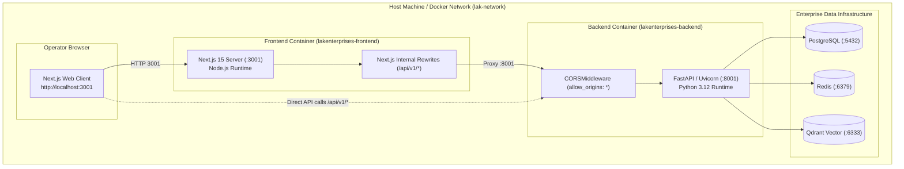

# Phase 12 — Infrastructure & Docker Design Evolution

## 1. Network & Component Wiring Evolution

In Phase 12, the system infrastructure evolved from a single backend service into a dual-service architecture comprising the Next.js Frontend Console and the FastAPI Backend Engine.

---

## 2. Component Routing & Docker Details

### A. Port Allocations & Routing Scheme
| Service | Internal Port | Host Port | Protocol | Purpose |
|---|---|---|---|---|
| **Next.js Frontend** | 3001 | 3001 | HTTP | Operator Web Console & Dashboard |
| **FastAPI Backend** | 8001 | 8001 | HTTP | REST APIs, OpenAPI, LangGraph Engine |
| **PostgreSQL** | 5432 | 5432 | TCP | Relational Entities, Audit Logs, Checkpoints |
| **Redis** | 6379 | 6379 | TCP | Rate Limiting & Short-term Sessions |
| **Qdrant** | 6333 | 6333 | HTTP / gRPC | Vector Search & Chunk Embeddings |

### B. Request Routing Flow
1. **Direct Browser Request:** The operator accesses `http://localhost:3001`.
2. **Reverse Proxy / Rewrites:** `next.config.js` is configured to rewrite `/api/v1/:path*` to `NEXT_PUBLIC_API_URL` (default `http://127.0.0.1:8001/api/v1/:path*`). This prevents Cross-Origin (CORS) complications during development and production container setups.
3. **Correlation Tracking:** The `LakApiClient` injects `X-Request-ID` into every HTTP header, which is captured by the backend's `AuditMiddleware` and correlated across logging outputs.
