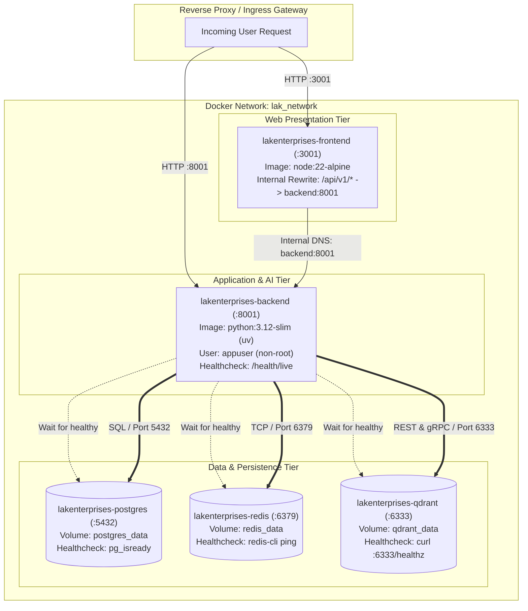

# Phase 14 — Infrastructure & Docker Design Evolution

## 1. Network & Component Wiring Evolution

In Phase 14, system infrastructure attained its finalized production state, orchestrating 5 containerized services within an isolated bridge network (`lak_network`) with strict dependency ordering and health check gates.

---

## 2. Component Routing & Docker Details

### A. Container Topology & Healthcheck Gates
| Container Service | Base Image | Ports | Healthcheck Probe | Restart Policy |
|---|---|---|---|---|
| `lakenterprises-postgres` | `postgres:16-alpine` | `5432:5432` | `pg_isready -U lak_user` | `unless-stopped` |
| `lakenterprises-redis` | `redis:7-alpine` | `6379:6379` | `redis-cli ping` | `unless-stopped` |
| `lakenterprises-qdrant` | `qdrant/qdrant:v1.12.1` | `6333:6333` | `curl -f :6333/healthz` | `unless-stopped` |
| `lakenterprises-backend` | `python:3.12-slim` | `8001:8001` | `curl -f :8001/health/live` | `unless-stopped` |
| `lakenterprises-frontend` | `node:22-alpine` | `3001:3001` | Node process status | `unless-stopped` |

### B. Security & Hardening Features
1. **Non-Root Execution:** The backend container drops root privileges and runs as `appuser (uid: 1000)`.
2. **Deterministic Layer Caching:** Uses `uv.lock` with `uv sync --frozen --no-dev` to produce immutable build artifacts without downloading untracked transitive dependencies.
3. **Explicit Bridge Isolation:** All services communicate via Docker internal DNS (`postgres`, `redis`, `qdrant`, `backend`) inside `lak_network`, preventing unwanted external exposure.
4. **Graceful Startup Sequencing:** The backend container specifies `condition: service_healthy` for Postgres, Redis, and Qdrant, preventing startup race conditions or migration crashes.
