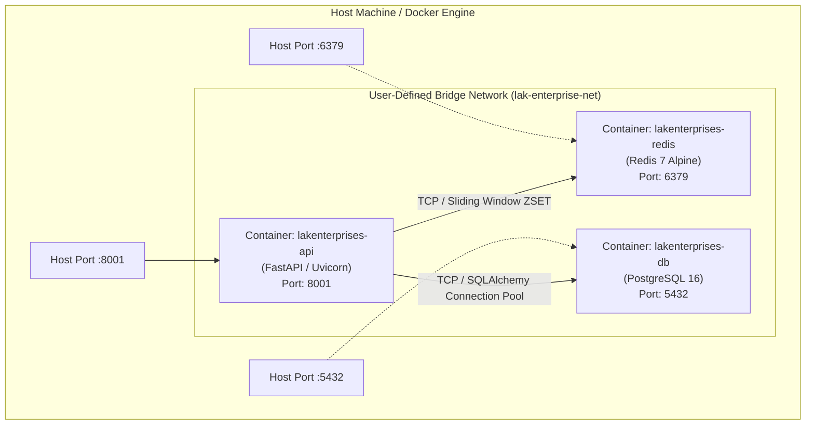
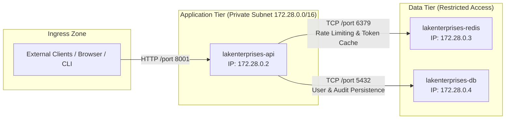
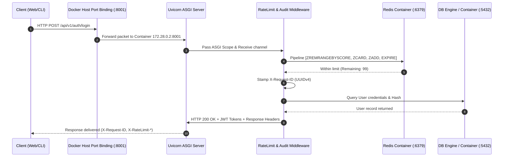

# Phase 3 — Infrastructure and Docker Networking Design Evolution

> **Scope:** Containerization topology, Docker networking, component wiring, and packet routing evolution for LakEnterprises Phase 3.

---

## 1. Overview & Evolution of the Deployment Model

In Phase 1 and Phase 2, the application ran primarily as a standalone Python process with SQLite.  
With the introduction of **Phase 3 (Identity, Rate Limiting, and Audit Logging)**, the infrastructure evolved into a multi-tier, decoupled distributed topology requiring fast cache layers (Redis) and persistent relational storage (PostgreSQL/SQLite).

---

## 2. Docker Network Architecture & Topology

### 2.1 The Bridge Network (`lak-enterprise-net`)
- All services communicate over an internal user-defined Docker bridge network named `lak-enterprise-net`.
- **DNS Resolution:** Containers resolve each other using their Docker service names (`redis:6379`, `postgres:5432`, `api:8001`) via Docker's embedded DNS server (`127.0.0.11`).
- **Network Isolation:** Only the FastAPI API gateway container exposes its port (`8001`) to the host network for external HTTP traffic. Database and cache ports are isolated from public ingress in production.

---

## 3. Component Wiring and Configuration Routing

### 3.1 FastAPI Application Wiring (`lakenterprises.app`)
The FastAPI runtime connects to external infrastructure services via lazy-initialized singletons configured through environment variables:

| Environment Variable | Default Value | Description |
|----------------------|---------------|-------------|
| `API_HOST` | `0.0.0.0` | IP interface bound by Uvicorn within the container |
| `API_PORT` | `8001` | TCP port exposed by FastAPI |
| `REDIS_URL` | `redis://localhost:6379/0` | Connection string for Redis sliding-window limiter |
| `DATABASE_URL` | `sqlite:///data/lakenterprises.db` | Connection string for SQLite or PostgreSQL persistence |
| `JWT_SECRET_KEY` | *(Configurable)* | Cryptographic HMAC key for signing JWT tokens |

### 3.2 Redis Connection Lifecycle & Graceful Fallback
1. **Connection Pooling:** `redis.ConnectionPool.from_url()` manages persistent sockets, eliminating connection handshake latency on every HTTP request.
2. **Health Probing (`/health/ready`):** Before reporting ready status, the API issues a lightweight `PING` command to Redis.
3. **Automatic Fallback:** If the connection drops or fails at runtime, `SlidingWindowRateLimiter` catches `redis.RedisError` and transparently routes the query to local in-memory sliding window deques.

---

## 4. End-to-End Packet Routing Diagram

The sequence below illustrates the life of an HTTP request traversing the container network boundaries:

---

## 5. Health Checks and Container Orchestration

Phase 3 introduces enterprise liveness and readiness probe endpoints:

1. **Liveness Probe (`GET /health/live`):**
   - Returns `{"status": "alive"}` immediately.
   - Used by Docker Compose or Kubernetes to determine if the container process is responsive.
2. **Readiness Probe (`GET /health/ready`):**
   - Verifies database connectivity and cache responsiveness.
   - Prevents traffic routing to containers during initialization or database migrations.
