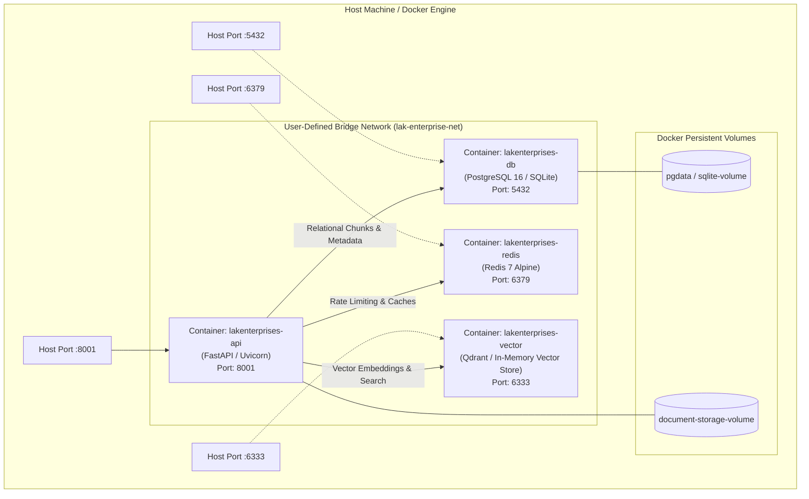
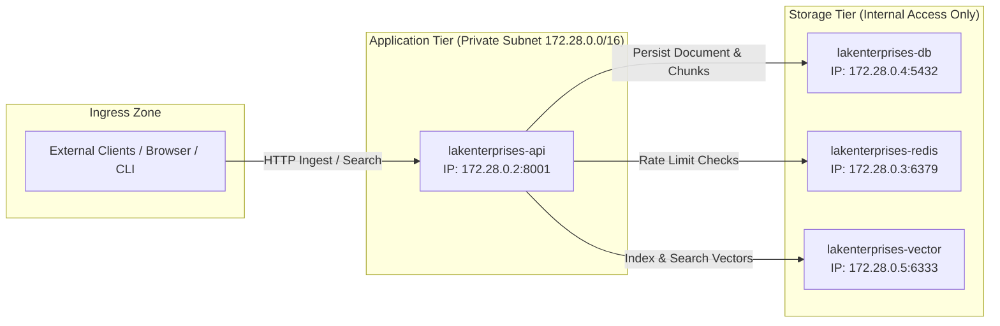
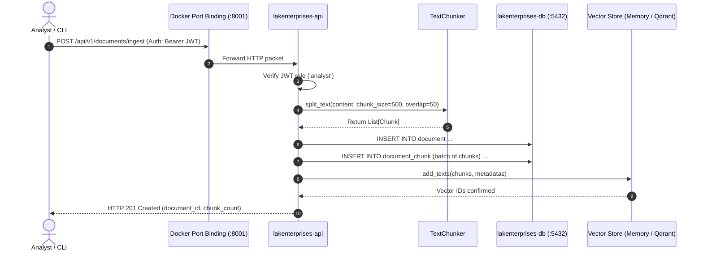

# Phase 4 — Infrastructure and Docker Networking Design Evolution

> **Scope:** Containerization topology, volume persistence, Docker networking, component wiring, and packet routing for the Document Processing Pipeline.

---

## 1. Overview & Evolution of the Deployment Model

In Phase 3, the infrastructure focused on authenticating requests via Redis and recording audit logs.  
With **Phase 4 (Document Processing Pipeline)**, the system expands to handle document uploads, boundary-aware text chunking, persistent relational metadata, dense vector indices, and hybrid retrieval.

---

## 2. Docker Network Architecture & Topology

### 2.1 The Bridge Network (`lak-enterprise-net`)
- All backend services communicate over an internal user-defined Docker bridge network named `lak-enterprise-net` with private subnet addressing (`172.28.0.0/16`).
- **Internal DNS Resolution:** Containers resolve peer services via embedded Docker DNS (`127.0.0.11`):
  - `postgres:5432` resolves to `172.28.0.4`
  - `redis:6379` resolves to `172.28.0.3`
  - `vectorstore:6333` resolves to `172.28.0.5`
- **Isolation:** Only `lakenterprises-api` exposes port `8001` externally to ingress routers or client applications. Database and vector ports remain shielded inside the private subnet.

---

## 3. Component Wiring and Configuration Routing

### 3.1 Document Ingestion Flow & Component Routing
When a client sends a document via `POST /api/v1/documents/ingest` or the CLI:

| Step | Component | Action Performed | Protocol / Port |
|------|-----------|------------------|-----------------|
| **1** | Reverse Proxy / Ingress | Receives HTTP payload and forwards to container | HTTP / TCP 8001 |
| **2** | `AuditMiddleware` | Records start timestamp, generates `X-Request-ID` | In-process ASGI |
| **3** | `RateLimitMiddleware` | Checks sliding window request counter in Redis | Redis TCP / 6379 |
| **4** | `require_role("analyst")` | Validates JWT token and checks for `analyst` or `admin` role | In-process JWT Verification |
| **5** | `TextChunker` | Chunks document into 500-char segments with 50-char overlap | In-process Python |
| **6** | `DocumentRepository` | Inserts `Document` row into SQL database | SQLAlchemy / PostgreSQL 5432 |
| **7** | `DocumentChunkRepository` | Batch inserts `DocumentChunk` rows linked to document ID | SQLAlchemy / PostgreSQL 5432 |
| **8** | `InMemoryVectorStore` | Computes dense embedding vectors and stores in-memory | In-process (or HTTP / 6333) |

---

## 4. End-to-End Packet Routing Diagram

The sequence below illustrates the life of a Document Ingestion and Hybrid Search request traversing the network topology:

---

## 5. Storage Volumes & Scaling Strategy

1. **Relational Volume (`pgdata`):** Persists all document metadata, author information, chunk indices, and foreign-key hierarchies.
2. **Vector Persistence:** In offline and testing modes, vectors reside in high-speed process memory. In containerized production, vectors can be mapped to an attached Qdrant storage volume at `/qdrant/storage`.
3. **Graceful Vector Re-indexing:** If the vector cache is ever restarted, the `DocumentService` can re-embed all chunks directly from the persistent database via `DocumentChunkRepository.get_all()`.
