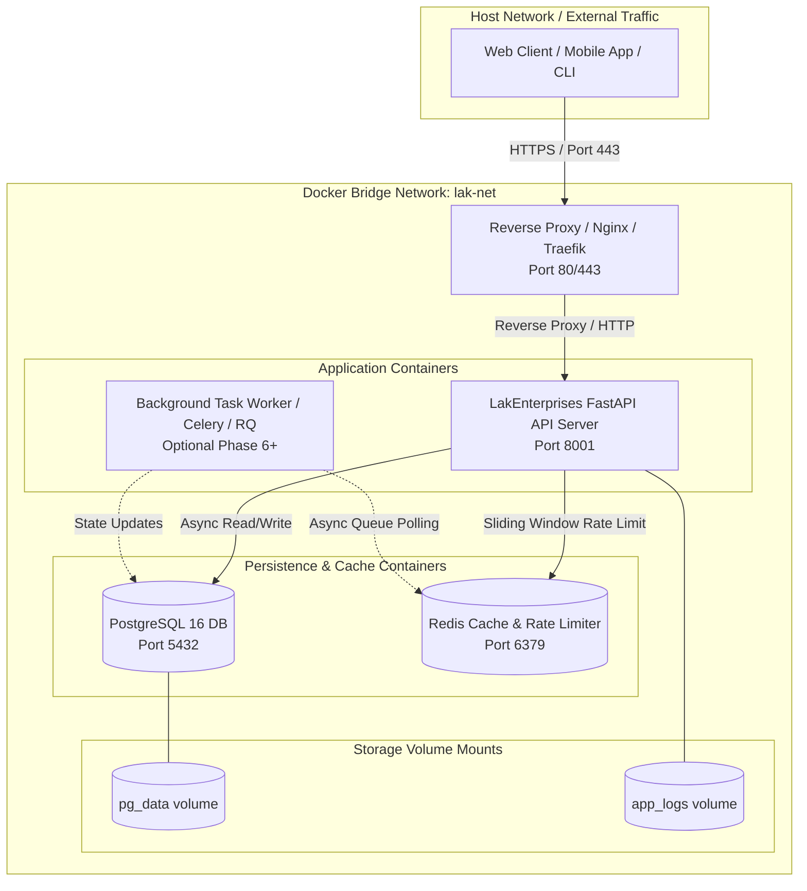

# Phase 5 Infrastructure & Docker Design Evolution

## 1. Overview of Phase 5 Infrastructure
In Phase 5, the LakEnterprises platform expanded from synchronous document queries into stateful enterprise workflow and task orchestration. This required robust component wiring, persistent database transactions, isolated network bridging between API servers and caching layers, and asynchronous background process readiness.

---

## 2. Docker Container Networking & Wiring Architecture



---

## 3. Component Wiring Details

| Component | Container Name | Internal Network Port | Responsibilities | Wiring Strategy |
|-----------|----------------|-----------------------|------------------|-----------------|
| **API Server** | `lakenterprises-api` | `8001` | Hosts `/api/v1/processes`, `/api/v1/approvals`, `/api/v1/documents`, `/api/v1/auth` | Connects via SQLAlchemy connection pool to Postgres; calls Redis for sliding-window rate limits. |
| **Relational DB** | `lakenterprises-postgres` | `5432` | Persists `ProcessTemplate`, `ProcessInstance`, `ProcessTask`, `ApprovalRequest`, `User`, `Role` | ACID guarantees with foreign key constraints, unique template names, and transactional rollback. |
| **Cache Store** | `lakenterprises-redis` | `6379` | Token invalidation cache and per-IP sliding window rate limiting | High-speed in-memory store; fallback to memory dictionary in offline testing. |
| **Volume Storage** | Named Volumes | Filesystem Mounts | Keeps data persistent across container redeployments | `data/` and DB directories are mounted on persistent Docker host volumes. |

---

## 4. Subtask Docker Evolution

### Subtask P5-1 & P5-2: Schema & State Machine Wiring
- Added relational migrations and SQLAlchemy model definitions for `process_template` and `process_instance`.
- Container health checks verify database schema initialization via `/health/ready` probe executing `SELECT 1`.

### Subtask P5-3: Approval & Task Routing
- Mounted approvals sub-router (`/api/v1/approvals`) and tasks endpoints (`/api/v1/processes/tasks`).
- Inter-container requests carry bearer JWTs; role claim inspection occurs in memory without hitting the database on every authentication check.

### Subtask P5-4: CLI & Automation Scripting
- Container entrypoints support executing CLI subcommands in one-off ephemeral containers:
  ```bash
  docker compose run --rm api lakenterprises process run-demo
  ```
- Ensures scheduled cron jobs and Kubernetes Jobs can execute process automation workflows deterministically inside the same container environment.
