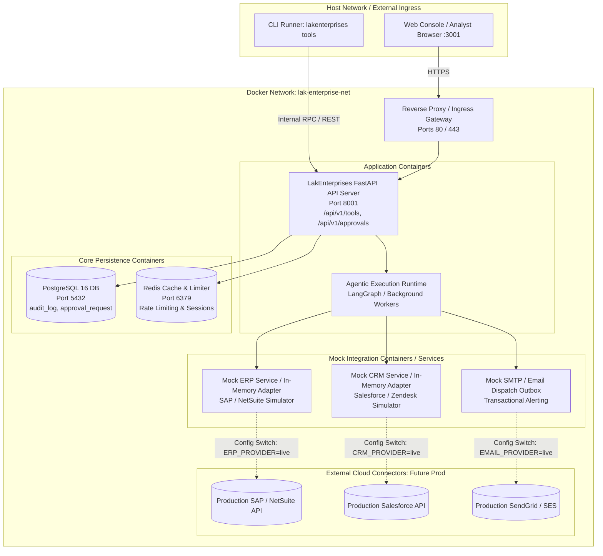

# Phase 6 Infrastructure & Docker Design Evolution

## 1. Overview of Phase 6 Infrastructure
In Phase 6, the LakEnterprises system evolved from internal state machines to an **agent-integrations platform** communicating with external enterprise services (ERP, CRM, Email, and Knowledge stores). This architecture requires careful network boundary enforcement, adapter virtualization, request isolation, and rate-governed outbound routing.

---

## 2. Docker Container Networking & Wiring Architecture

---

## 3. Component Wiring Details

| Component | Container / Runtime Node | Internal Network Port | Responsibilities | Wiring Strategy |
|-----------|--------------------------|-----------------------|------------------|-----------------|
| **Tools API Router** | `lakenterprises-api` | `8001` | Exposes `/api/v1/tools`, parameter schemas, execution endpoints | Mounted inside FastAPI application pipeline; protected by `AuditMiddleware` and `RateLimitMiddleware`. |
| **Tool Policy Engine** | In-Process Core Service | Internal Memory | Evaluates role permissions, risk tier thresholds, and approval tokens | Embedded in `ToolExecutor`; directly queries `ApprovalRequestRepository` via pooled DB connection. |
| **ERP Integration Adapter** | `MockERPAdapter` (or standalone container) | Virtual / In-Memory | Purchase orders, inventory stock, vendor catalog operations | Implements `ERPAdapter` Protocol. Can be swapped with live REST/gRPC client without changing agent code. |
| **CRM Integration Adapter** | `MockCRMAdapter` (or standalone container) | Virtual / In-Memory | Account records, support ticket updates, customer ARR lookup | Implements `CRMAdapter` Protocol; supports simulated outages for resiliency and retry testing. |
| **Email Dispatch Adapter** | `MockEmailAdapter` | Virtual / In-Memory | Outbox queue, delivery status tracking, message formatting | Stores dispatched alerts in-memory during testing; configurable to route to AWS SES or SendGrid. |
| **Audit Persistence** | `lakenterprises-postgres` | `5432` | Immutable logging of every tool execution, timing, and policy check | ACID relational transactions with foreign key relationships and index on `entry_id` and `timestamp`. |

---

## 4. Subtask Docker & Infrastructure Evolution

### Subtask P6-1: Policy Engine & Tool Registry Infrastructure
- Tools and policy evaluation run inside the core API runtime with zero extra external network latency (< 1ms execution checks).
- Standard JSON parameter schemas exposed at `/api/v1/tools/schemas` for function calling consumption by LLM orchestrators.

### Subtask P6-2 & P6-4: Read-Only Tools & Mock Enterprise Integrations
- Isolated integration adapters prevent vendor lock-in.
- Pre-populated test fixtures allow complete offline execution (`make test` and CLI execution) with zero external network access required.
- Simulated network failure toggles (`simulate_outage=True`) allow automated validation of circuit breakers and graceful error reporting.

### Subtask P6-3: Approval-Gated Write Infrastructure
- High-risk operations (purchase orders, financial alterations) cannot directly write to backend services.
- The infrastructure pauses execution and writes an `approval_request` record to PostgreSQL.
- Resumption occurs safely by passing the verified `approval_id` back through the same `ToolExecutor` gateway.
