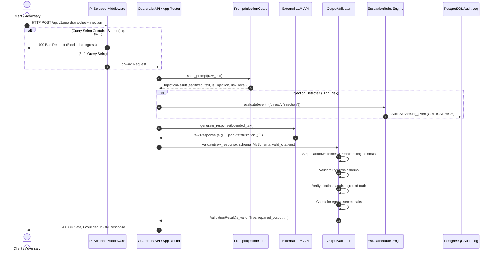

# Phase 7 Infrastructure & Docker Design Evolution

## 1. Overview of Phase 7 Infrastructure
In Phase 7, the LakEnterprises system hardened its operational boundaries against adversarial attacks, data leaks, and operational catastrophes. The infrastructure architecture ensures that untrusted data from client browsers, third-party integrations, and LLM responses passes through deterministic security checkpoints before interacting with persistence layers or end users.

---

## 2. Docker Container Networking & Middleware Routing Architecture

```mermaid
flowchart TD
    subgraph External Network / Untrusted Zone
        Client[Web Browser / API Client]
        Attacker[Adversary / Malicious Ingress]
    end

    subgraph Docker Bridge Network: lak-enterprise-net
        Gateway[Nginx / Ingress Gateway\nReverse Proxy :80 / :443]

        subgraph FastAPI Core Application Container :8001
            MW[PIIScrubberMiddleware\n- Inspects query strings\n- Blocks raw secrets]
            
            subgraph Guardrails Subsystem Module
                Scrub[PIIScrubber Engine\nAWS, OpenAI, PEM, Luhn CC]
                Guard[PromptInjectionGuard\nJailbreak, Token & Base64 Guard]
                OutVal[OutputValidator\nJSON Repair, Citation Grounding]
                EscEngine[EscalationRulesEngine\nSeverity Tiers & Alert Rules]
            end

            subgraph Router Layer
                APIRouter[/api/v1/guardrails\n/scrub, /check-injection, /validate-output]
                CoreRouter[/api/v1/tools, /api/v1/approvals, /api/v1/processes]
            end
        end

        subgraph Core Data & Persistence Containers
            Postgres[(PostgreSQL 16 DB :5432\naudit_log, processes, security_events)]
            Redis[(Redis Cache :6379\nRate Limiting & Threat Counters)]
        end

        subgraph External Cloud Services
            LLMProvider[(OpenAI / Anthropic APIs\nExternal Secure Egress)]
            PagerDuty[(Incident Response / Pager Webhook)]
        end
    end

    Client -->|HTTPS| Gateway
    Attacker -->|HTTPS Malicious Query| Gateway
    Gateway -->|Forward| MW
    MW -->|Blocked: Plaintext Secret| Attacker
    MW -->|Pass Sanitized| APIRouter
    MW -->|Pass Sanitized| CoreRouter
    
    CoreRouter --> Guard
    Guard --> LLMProvider
    LLMProvider --> OutVal
    OutVal --> CoreRouter

    EscEngine -->|Audit Security Incident| Postgres
    EscEngine -->|Critical Alert Triggered| PagerDuty
    APIRouter --> Postgres
```

---

## 3. Request Lifecycle & Security Filtering Sequence



---

## 4. Key Infrastructure Hardening Policies
1. **Network Isolation:** The PostgreSQL and Redis containers do not publish external ports; they communicate exclusively through the internal Docker bridge network `lak-enterprise-net`.
2. **Zero Ingress Secret Transmission:** Query strings containing AWS secrets or OpenAI API keys are rejected at the ASGI middleware layer before touching business routers.
3. **Egress Sanitization:** All LLM outputs are inspected for credential exfiltration before transmission across the Docker gateway.
4. **Resilient Failure Mode:** If an LLM returns malformed JSON with markdown blocks or trailing commas, the `OutputValidator` repairs it in memory without initiating an expensive retry API call to external LLM providers.
