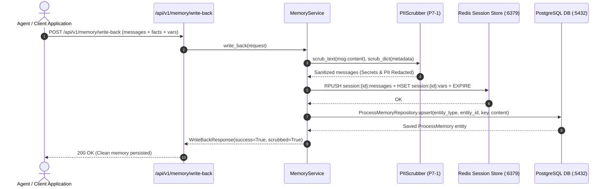

# Phase 8 Infrastructure & Docker Design Evolution

## 1. Overview of Phase 8 Infrastructure
In Phase 8, the LakEnterprises platform upgraded its runtime infrastructure to manage stateful conversations and enterprise knowledge across distributed worker instances. By pairing a high-speed Redis cluster/container for volatile session state with a relational PostgreSQL cluster for durable process facts, the system achieves low-latency prompt recall and resilient data durability.

---

## 2. Docker Container Networking & Component Wiring

```mermaid
flowchart TD
    subgraph External Network
        BrowserClient[Web Console / Analyst Browser :3001]
        RESTCaller[External API / Enterprise Webhook]
    end

    subgraph Docker Network: lak-enterprise-net
        Gateway[Nginx / Ingress Gateway\nReverse Proxy :80 / :443]

        subgraph FastAPI Core Application Container :8001
            MW[PIIScrubberMiddleware]
            
            subgraph Memory Subsystem Module
                SStore[ShortTermSessionStore\nSession turns, variables, TTL]
                LStore[LongTermProcessMemoryStore\nProcess facts, customer rules]
                MService[MemoryService\nRecall synthesis & scrubbed write-back]
            end

            subgraph Router Layer
                MemRouter[/api/v1/memory\n/sessions, /long-term, /recall, /write-back]
                AppRouter[/api/v1/processes, /api/v1/tools, /api/v1/guardrails]
            end
        end

        subgraph In-Memory Data Container :6379
            RedisDB[(Redis Cache & Session Store\nsession:{id}:messages\nsession:{id}:vars\nsession:{id}:meta)]
        end

        subgraph Relational Persistence Container :5432
            PostgresDB[(PostgreSQL 16 DB\nTable: process_memory\nTable: audit_log, processes)]
        end
    end

    BrowserClient -->|HTTPS| Gateway
    RESTCaller -->|HTTPS| Gateway
    Gateway --> MW
    MW --> MemRouter
    MW --> AppRouter
    
    MemRouter --> MService
    MService --> SStore
    MService --> LStore
    
    SStore -->|TCP / Redis Protocol :6379| RedisDB
    LStore -->|SQLAlchemy / PostgreSQL :5432| PostgresDB
```

---

## 3. Data Flow & Request Lifecycle Sequence



---

## 4. High-Availability & Disaster Recovery Policies
1. **Volatile vs Durable State Separation:**
   - **Volatile (Redis):** Conversational dialogue history and session scratchpad variables are stored in Redis with automated TTL expiry (default: 86,400s / 24 hours). If Redis restarts, conversations gracefully reset without affecting core business processes.
   - **Durable (PostgreSQL):** Long-term corporate facts, customer preferences, and process learnings reside in PostgreSQL backed by write-ahead logs (WAL) and automated backups.
2. **Zero Ingress Secret Persistence:**
   - Because `MemoryService` invokes `PIIScrubber` prior to invoking Redis `RPUSH` or SQLAlchemy `flush()`, database and Redis dumps are strictly free of raw customer credentials and payment cards.
3. **In-Memory Fallback:**
   - In environments where Redis is not provisioned (e.g., local development, developer laptop test runs, or temporary Redis outages), `ShortTermSessionStore` falls back to in-memory dictionaries transparently without crashing the server.
