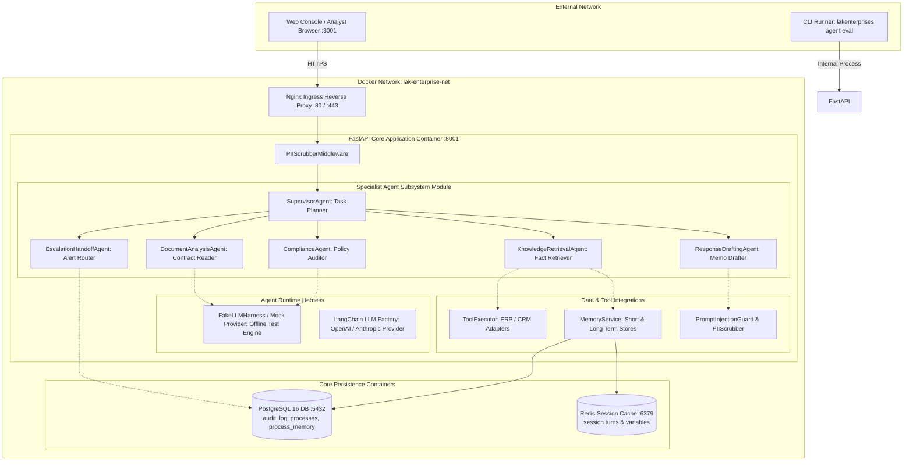
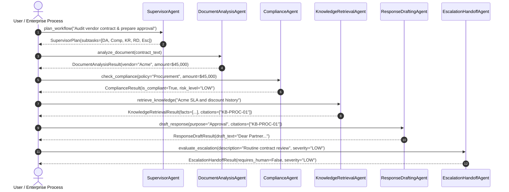

# Phase 9 Infrastructure & Docker Design Evolution

## 1. Overview of Phase 9 Infrastructure
In Phase 9, the LakEnterprises system established the runtime infrastructure for executing specialist agents within the containerized backend. By standardizing input and output contracts into validated Pydantic models, each specialist agent operates as a decoupled micro-task runner that can execute locally, in background worker pools, or across future distributed agent clusters.

---

## 2. Docker Container Networking & Specialist Agent Wiring

---

## 3. Specialist Agent Execution Sequence

---

## 4. Key Infrastructure & Reliability Policies
1. **Deterministic Test Isolation:** The `FakeLLMHarness` operates entirely in memory without requiring outbound network sockets, allowing tests and CLI commands (`lakenterprises agent eval`) to execute inside sandboxed or offline Docker build environments.
2. **Schema Boundary Enforcement:** All cross-agent communication is serialized into typed Pydantic models. A malformed response from an agent or LLM fails early at the agent boundary rather than corrupting database tables or downstream workflow graphs.
3. **Zero Network Latency in CI:** Benchmark evaluation scenarios run in $\le 1$ second across the entire suite, enabling rapid local development feedback and reliable continuous integration.
