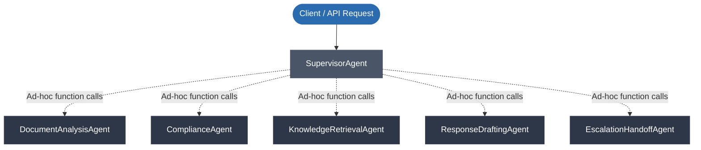

# Phase 10 System Design Evolution: Workflow Graph and Tracing

## 1. Architectural Evolution

### Initial Starting Point (Early Phase 10)
At the conclusion of Phase 9, LakEnterprises had developed 6 discrete specialist agents (`SupervisorAgent`, `DocumentAnalysisAgent`, `ComplianceAgent`, `KnowledgeRetrievalAgent`, `ResponseDraftingAgent`, `EscalationHandoffAgent`) and evaluated them with a benchmark test suite. However, they were standalone components without a unified state machine, persistent checkpoints, or a streaming telemetry bus.



**Limitations of Initial State:**
1. **No Shared State Model:** Data between agents was manually copied across dictionaries without centralized validation.
2. **No Pause/Resume Capability:** If a task required executive approval, the process could not pause in memory and resume later; it would lose state upon process termination.
3. **No Observability or Telemetry:** External clients could not observe node-by-node execution or stream intermediate steps.

---

### Intermediate Evolution (Subtasks P10-1 through P10-4: State, Checkpointer, and Specialist Nodes)
In this phase, we encapsulated the shared state into `WorkflowState` (TypedDict) and created `ProcessStateCheckpointer` wrapping LangGraph `MemorySaver` alongside individual graph nodes.

```mermaid
flowchart TD
    subgraph State & Checkpoint Foundation: P10-1
        State[WorkflowState: TypedDict\nprocess_id, goal, input_payload, history, citations]
        CP[ProcessStateCheckpointer\nsave_checkpoint, get_checkpoint, rewind]
    end

    subgraph Node Wrappers: P10-2, P10-3, P10-4
        NodeOrch[orchestrator_node\nroute_orchestrator]
        NodeDoc[document_analyst_node]
        NodeComp[compliance_node]
        NodeKR[knowledge_retriever_node]
        NodeDraft[response_draft_node]
        NodeEsc[escalation_node]
        NodeFin[finalize_node]
    end

    State --> CP
    CP -.-> NodeOrch
    NodeOrch --> NodeDoc
    NodeDoc --> NodeComp
    NodeComp --> NodeKR
    NodeKR --> NodeDraft
    NodeDraft --> NodeEsc
    NodeEsc --> NodeFin
```

---

### Advanced Final State (Subtasks P10-5 and P10-6: StateGraph, Engine, Tracer, and SSE Streaming)
In the final architecture, we compiled the complete LangGraph `StateGraph(WorkflowState)`, introduced `WorkflowEngine` for lifecycle isolation, built `WorkflowTracer` with async broadcast queues, and exposed REST/SSE routes under `/api/v1/workflow`.

```mermaid
flowchart TD
    Client([HTTP / SSE Client]) -->|POST /run /resume| Routes[/api/v1/workflow Routes/]
    Routes --> Engine[WorkflowEngine]
    
    subgraph LangGraph Compiled StateGraph
        Start([START]) --> Orch[orchestrator_node]
        Orch --> Doc[document_analyst_node]
        Doc --> Comp[compliance_node]
        Comp --> KR[knowledge_retriever_node]
        KR --> Draft[response_draft_node]
        Draft --> Esc[escalation_node]
        Esc --> Fin[finalize_node]
        Fin --> Term([END])
    end

    subgraph Persistence & Audit
        MemSaver[(LangGraph MemorySaver)]
        CheckpointerStore[(ProcessStateCheckpointer\nSnapshot History Store)]
    end

    subgraph Telemetry & Observability: P10-6
        Tracer[WorkflowTracer Event Bus]
        StreamQueue[Async Broadcast Queues]
        SSE[GET /{id}/events/stream\nServer-Sent Events]
    end

    Engine --> Start
    Orch -.->|State & Checkpoint| CheckpointerStore
    Doc -.->|State & Checkpoint| CheckpointerStore
    Comp -.->|State & Checkpoint| CheckpointerStore
    Esc -.->|State & Checkpoint| CheckpointerStore
    Fin -.->|Final State| MemSaver

    Engine -.->|emit telemetry| Tracer
    Tracer --> StreamQueue
    StreamQueue --> SSE
    SSE --> Client
```

---

## 2. Subtask Breakdown & Implementation Details

### Subtask P10-1: Process State and Checkpointer
- **File:** `src/lakenterprises/workflow/state.py`
- Defined `WorkflowState` specifying `process_id`, `goal`, `title`, `current_status`, `active_node`, `plan`, `document_analysis`, `compliance`, `knowledge`, `draft`, `escalation`, `approval_required`, `routing_history`, `agent_outputs`, `citations`, and `final_output`.
- Created `ProcessStateCheckpointer` wrapping LangGraph `MemorySaver` with custom audit snapshots, step numbers, timestamped history, and time-travel rewind capabilities.

### Subtask P10-2: Orchestrator Graph Nodes
- **File:** `src/lakenterprises/workflow/nodes_orchestrator.py`
- `orchestrator_node`: Evaluates high-level goal, invokes `SupervisorAgent.plan_workflow()`, populates state plan, and records execution audit log.
- `route_orchestrator`: Implements dynamic conditional routing based on planned specialist agents.

### Subtask P10-3: Document Investigation Graph Nodes
- **File:** `src/lakenterprises/workflow/nodes_investigate.py`
- `document_analyst_node`: Extracts vendor details, amounts, dates, and risk signals via `DocumentAnalysisAgent`.
- `knowledge_retriever_node`: Gathers grounded enterprise facts and citations via `KnowledgeRetrievalAgent`.

### Subtask P10-4: Resolution and Risk Graph Nodes
- **File:** `src/lakenterprises/workflow/nodes_resolution.py`
- `compliance_node`: Audits transaction against enterprise policies via `ComplianceAgent`.
- `escalation_node`: Evaluates operational severity and human handoff via `EscalationHandoffAgent`.
- `response_draft_node`: Composes customer communication via `ResponseDraftingAgent`.
- `finalize_node`: Consolidates final outputs, citations, and terminal status.

### Subtask P10-5: Graph Wiring and Run Endpoint
- **Files:** `src/lakenterprises/workflow/graph.py`, `src/lakenterprises/workflow/routes.py`
- Built `build_enterprise_workflow_graph()` compiling `StateGraph(WorkflowState)`.
- Created `WorkflowEngine` managing `run()` and `resume()`.
- Exposed REST API endpoints:
  - `POST /api/v1/workflow/run`
  - `GET /api/v1/workflow/{process_id}/state`
  - `POST /api/v1/workflow/{process_id}/resume`
  - `GET /api/v1/workflow/{process_id}/checkpoints`

### Subtask P10-6: Workflow Tracer and Events Stream
- **File:** `src/lakenterprises/workflow/tracer.py`
- Implemented `WorkflowTraceEvent` and `WorkflowTracer` event bus.
- Added real-time asynchronous queue subscriptions for Server-Sent Events (SSE) streaming at `GET /api/v1/workflow/{process_id}/events/stream`.
