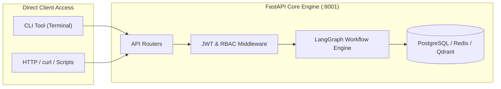
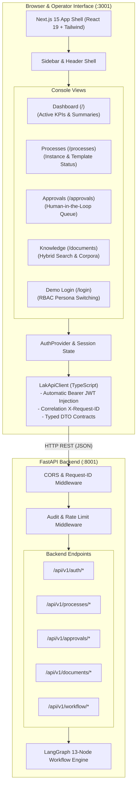

# Phase 12 — Project System Design Evolution

## 1. Simple Initial Design (Start of Phase 12)

Prior to Phase 12, LakEnterprises existed purely as a headless backend API and CLI tool. Client interaction occurred solely through direct HTTP calls (via curl, Postman, or integration scripts) or local terminal commands:

### Limitations of Initial Design:
- **No Human-Friendly UI:** Business stakeholders and operations teams could not visually track workflow progress or inspect agent states.
- **Manual Decision Submissions:** Approving or rejecting high-dollar disputes required manual HTTP POST payloads.
- **Static Verification:** Testing RBAC required generating and pasting JWT tokens into header parameters manually.

---

## 2. Advanced Evolved System Design (End of Phase 12)

With Phase 12 complete, LakEnterprises features a dedicated, modern Next.js 15 Console UI shell running on port 3001, communicating with the FastAPI backend through a typed API client:

---

## 3. Subtask Evolutionary Progression

### Subtask P12-1: App Shell and Navigation Frame
- Scaffolded Next.js 15 workspace with Tailwind CSS and responsive layout.
- Established persistent `Sidebar` and `Navbar` showing service health and identity state.

### Subtask P12-2: Strongly Typed API Client
- Implemented `LakApiClient` wrapping standard fetch with Bearer token persistence in localStorage.
- Integrated correlation tracking via `X-Request-ID` header generation on every outgoing client request.

### Subtask P12-3: RBAC Layout & Session Management
- Created `AuthProvider` context managing active tokens, user profiles, and permission predicates (`hasRole`).
- Built dedicated `/login` page enabling 1-click persona switching (Viewer, Analyst, Administrator) for live RBAC validation.

### Subtask P12-4: Dashboard & Resource List Views
- Built comprehensive `/` overview dashboard with metric cards and recent activity tables.
- Built `/processes`, `/approvals`, and `/documents` pages for managing enterprise workflows, approving disputes, and conducting hybrid vector search.
