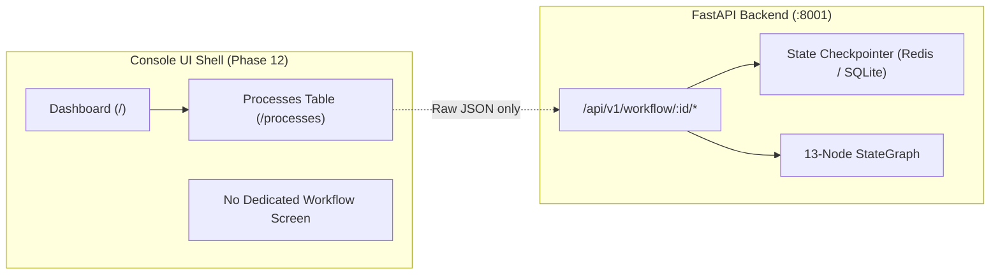
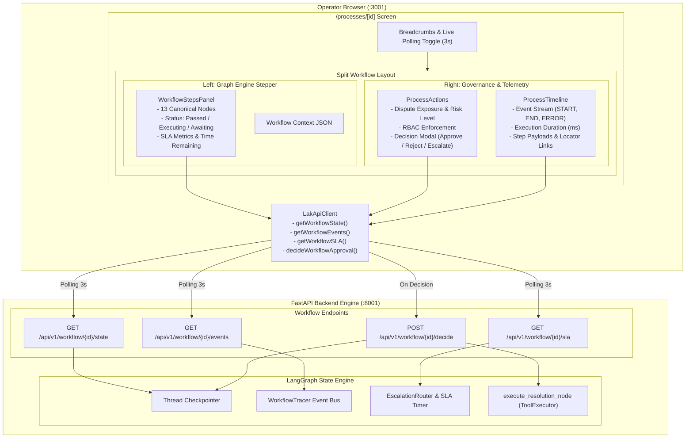

# Phase 13 — Project System Design Evolution

## 1. Simple Initial Design (Start of Phase 13)

At the beginning of Phase 13, the frontend had a general shell with list pages (`/processes`, `/approvals`), but opening a specific process had no dedicated workflow interaction screen. Workflow execution and pause gates were inspectable only through CLI logs or raw JSON API endpoints:

### Limitations:
- Operators could not see which node of the 13-node graph was running.
- No live polling or timeline of step durations.
- Human approval decisions required raw curl POSTs to `/api/v1/workflow/{id}/decide`.

---

## 2. Advanced Evolved System Design (End of Phase 13)

By the end of Phase 13, LakEnterprises features an interactive, real-time Process Workflow Screen at `/processes/[id]` with automated polling, telemetry stream, step visualization, and approval decision controls:

---

## 3. Subtask Evolutionary Progression

### Subtask P13-1: Process Detail and Timeline Layout
- Created Next.js dynamic route `frontend/src/app/processes/[id]/page.tsx`.
- Designed the master screen header with breadcrumbs, status pill, and 3-column responsive grid layout.
- Implemented `ProcessTimeline` displaying recorded chronological trace events, duration metrics, and node payloads.

### Subtask P13-2: Workflow Steps Panel with Polling
- Implemented `WorkflowStepsPanel` mapping out the canonical 13-node LangGraph execution sequence.
- Wired automated 3-second polling interval with pause/resume toggle for non-intrusive monitoring.
- Incorporated SLA countdown cards tracking tier limits, elapsed time, and breach warnings.

### Subtask P13-3: Approve, Reject, and Escalate Actions UI
- Implemented `ProcessActions` featuring real-time risk summaries and dispute exposure badges.
- Built interactive confirmation modals capturing operator justification notes.
- Integrated RBAC permission gating ensuring only authorized roles (`analyst`, `admin`) can submit approval decisions.

### Subtask P13-4: Frontend Integration Tests
- Created Node.js unit tests in `frontend/tests/workflow-screen.test.js` validating client method signatures.
- Implemented comprehensive FastAPI backend integration tests in `tests/test_frontend_workflow_screen.py` verifying the full workflow run, state query, events stream, SLA metrics, and approval decision cycle.
