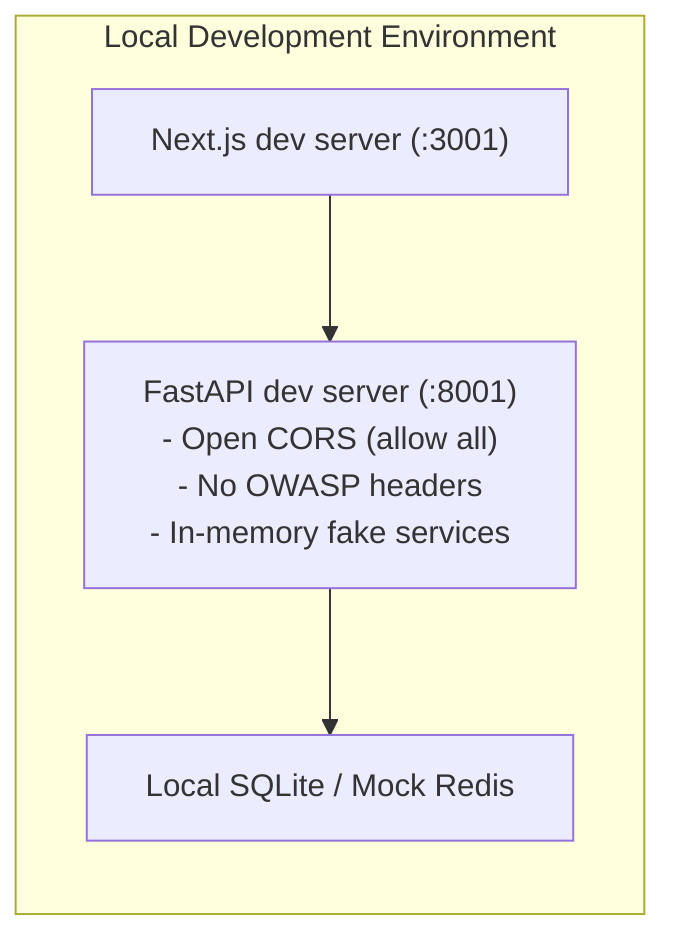
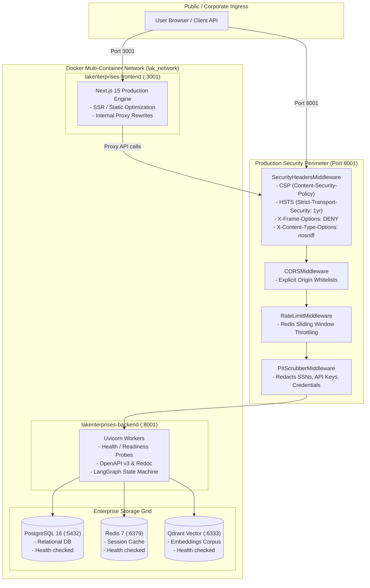

# Phase 14 — Project System Design Evolution

## 1. Simple Initial Design (Start of Phase 14)

Prior to Phase 14, the application consisted of application code and UI components designed primarily for local development workflows. It lacked containerization blueprints, production security policies, and automated end-to-end smoke verification:

### Limitations:
- **No Container Standardization:** Different environments (Mac, Linux, Windows) required manual dependency setups.
- **Security Vulnerabilities:** Missing OWASP security headers (no CSP, no X-Frame-Options, no HSTS) left browsers vulnerable to clickjacking or injection attacks.
- **Missing Deployment Blueprints:** Lack of an operational runbook or docker orchestration stack for staging and production environments.

---

## 2. Advanced Evolved System Design (End of Phase 14)

By the conclusion of Phase 14, LakEnterprises features an enterprise-hardened, containerized production architecture:

---

## 3. Subtask Evolutionary Progression

### Subtask P14-1: Rate Limiting, CORS, and Security Headers
- Implemented `SecurityHeadersMiddleware` enforcing OWASP headers (`nosniff`, `DENY`, `HSTS`, `CSP`).
- Restructured `CORSMiddleware` in `src/lakenterprises/app.py` to support explicit origin whitelists for production domains.

### Subtask P14-2: Docker Compose for Local Prod-Like Stack
- Created multi-stage `Dockerfile` (Python 3.12 slim, non-root user `appuser`, `uv` package manager).
- Created `frontend/Dockerfile` (Node.js 22 alpine).
- Created root `docker-compose.yml` orchestrating all 5 services with internal container health checks and volume persistence.

### Subtask P14-3: API Documentation (OpenAPI / Redoc)
- Standardized FastAPI metadata, versioning (1.0.0), and documentation endpoints (`/docs`, `/redoc`, `/openapi.json`).
- Verified schema documentation rendering across all 40+ endpoints.

### Subtask P14-4: End-to-End Smoke Tests
- Created `tests/test_e2e_smoke.py` validating liveness/readiness probes, security headers, documentation rendering, and full multi-agent process cycles.

### Subtask P14-5: Deployment Guide and Runbook
- Authoring `docs/deployment_guide_runbook.md` with port maps, environment variable templates, zero-downtime deployment strategies, and incident response procedures.
