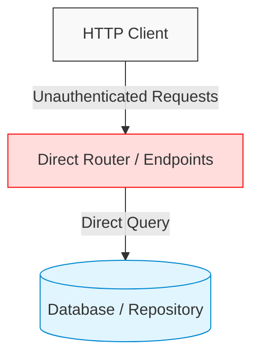
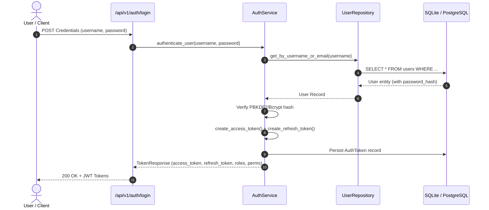
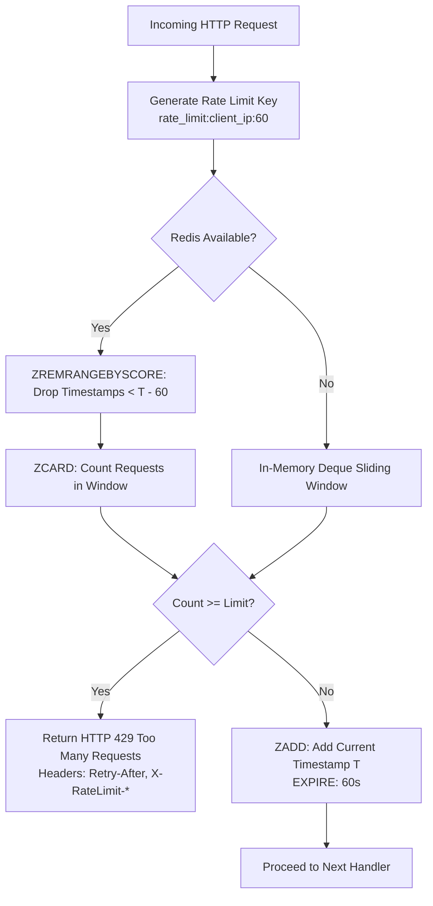
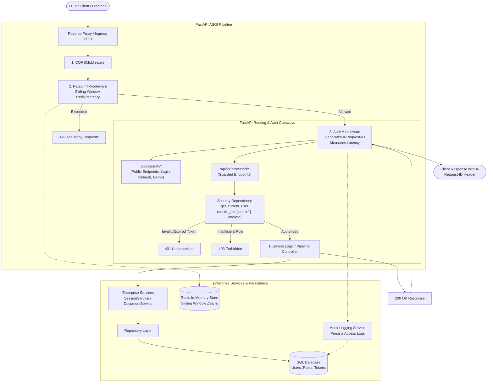

# Phase 3 — System Design Evolution: Identity and Access Control

> **Scope:** Architectural journey and design evolution of the security, authorization, rate limiting, and auditing infrastructure in LakEnterprises.

---

## 1. Executive Summary & Design Goals

In an enterprise-grade AI and knowledge research platform, security cannot be an afterthought bolted onto endpoints. It must be an integral architectural layer that guarantees:
- **Zero-Trust Identity Verification:** Every API call is authenticated and authorized statelessly using industry-standard JSON Web Tokens (JWT).
- **Least-Privilege Role-Based Access Control (RBAC):** Granular separation of concerns across 6 distinct roles (`admin`, `manager`, `analyst`, `viewer`, `auditor`, `system`) and 25 operational permissions.
- **DDoS and Brute-Force Resilience:** Distributed sliding-window rate limiting backed by Redis sorted sets with zero-overhead in-memory fallback.
- **Non-Repudiation & Auditability:** Transparent ASGI request interception recording execution duration, user identity, IP address, and status codes.

---

## 2. Architectural Evolution Across Phase 3

### Stage 1: Initial Baseline Design (Pre-Phase 3)

At the onset of Phase 3, the backend only supported basic database entities without an HTTP authorization gateway, token generation, rate limiting, or request tracking.

**Limitations of Baseline Design:**
- Endpoints were unprotected; any client could trigger expensive retrieval queries or administrative mutations.
- No session tracking or revocation mechanisms.
- Vulnerable to volumetric abuse, brute-force password guessing, and API scrapers.
- No audit trails for security investigations or regulatory compliance.

---

### Stage 2: Subtasks P3-1 & P3-2 — Cryptographic JWT & Granular RBAC

In Subtask P3-1 and P3-2, we implemented the identity core:
1. **Password Hashing:** PBKDF2-HMAC-SHA256 with 100,000 iterations and per-user unique 32-byte cryptographically secure salts.
2. **Dual-Token Architecture:**
   - **Access Token:** Short-lived (60 minutes) containing signed claims (`sub`, `roles`, `permissions`, `exp`, `jti`).
   - **Refresh Token:** Long-lived (7 days) stored with hashed lookup and atomic revocation semantics.
3. **Role & Permission Matrix:** Pre-seeded with 6 enterprise roles and 25 fine-grained permissions.

---

### Stage 3: Subtask P3-3 — Distributed Sliding-Window Rate Limiter

Fixed-window rate limiters suffer from boundary traffic bursts (e.g., doubling the limit at window transitions). To solve this, Phase 3 introduced a **Sliding Window Counter** using **Redis Sorted Sets (ZSET)**.

#### Algorithmic Design:
1. Key structure: `rate_limit:{client_ip}:{window_seconds}`
2. At timestamp $T$:
   - `ZREMRANGEBYSCORE key 0 (T - window_seconds)`: Prune entries older than the rolling window.
   - `ZCARD key`: Count remaining entries in the current window.
   - If count $\ge$ limit: Reject request with HTTP 429 and calculate `Retry-After`.
   - Else: `ZADD key T T` and `EXPIRE key window_seconds`.
3. **Graceful Fallback:** If Redis is down or unavailable, the limiter automatically falls back to an in-memory `collections.deque` with zero downtime.

---

### Stage 4: Subtask P3-4 & Final Integrated System Design

The final system design coordinates ASGI middleware, rate limiting, audit logging, and dependency-injected security guards into a unified, high-performance pipeline.

---

## 3. Security Specifications & Invariants

1. **One-Way Architectural Flow:**
   `app / routes` $\rightarrow$ `services` $\rightarrow$ `repositories` $\rightarrow$ `models`.
2. **Stateless Verification:**
   Core API verification uses HMAC-SHA256 signature checking without requiring synchronous DB queries on every request.
3. **Instant Revocation Support:**
   Critical security actions (e.g., logout, security lockout) flag token identifiers in an in-memory blacklist and database cache.
4. **Resilient Defaults:**
   If Redis or logging stores face temporary latency, the system fails open safely with audit warnings, ensuring core business availability.
