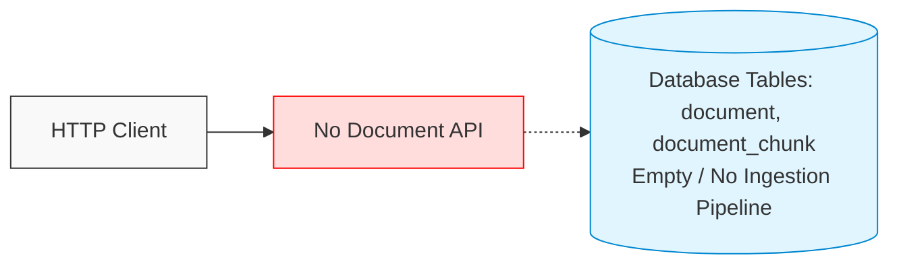
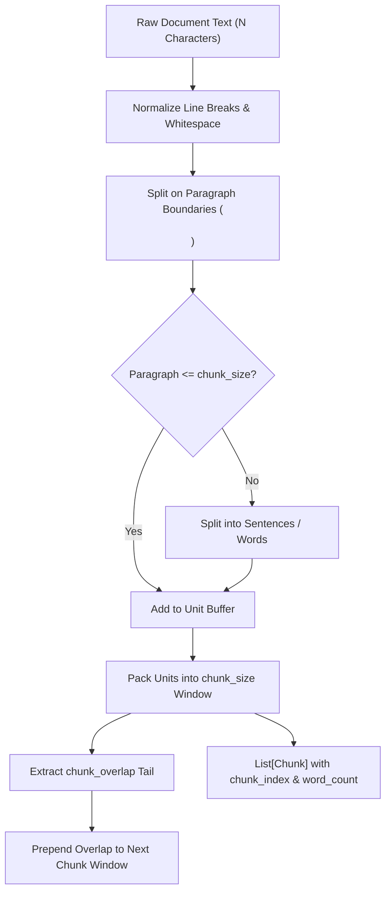
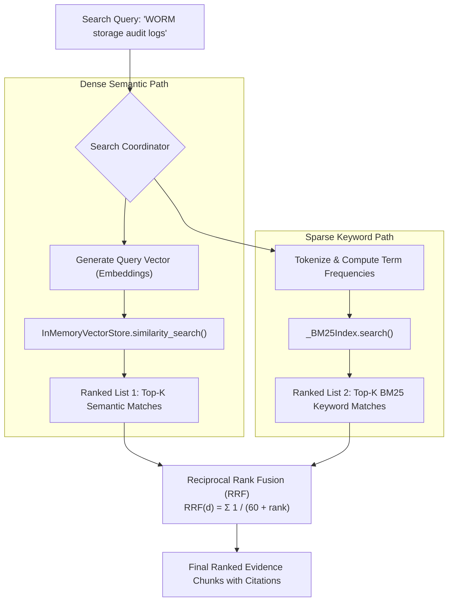

# Phase 4 — System Design Evolution: Document Processing & Hybrid Retrieval

> **Scope:** Evolution of document ingestion, boundary-aware chunking, vector embeddings, and hybrid retrieval architecture in LakEnterprises.

---

## 1. Executive Summary & Design Goals

Phase 4 bridges static enterprise documentation with semantic AI workflows. The architectural requirements dictate:
- **Context-Preserving Ingestion:** Ingest raw text and Markdown without truncation or semantic degradation.
- **Boundary-Aware Overlapping Chunking:** Respect natural paragraph and sentence boundaries with configurable character windows and sliding overlap.
- **Polyglot Hybrid Search:** Combine dense vector representations (capturing latent semantic intent) with sparse BM25 indices (capturing exact keywords, domain acronyms, and product IDs).
- **Reciprocal Rank Fusion (RRF):** Combine disparate score distributions into a robust, normalized ranking without manual score normalization heuristics.
- **Role-Governed API & CLI Ingestion:** Protect write and destructive endpoints via RBAC while allowing public search and document browsing for authorized analysts and viewers.

---

## 2. Architectural Evolution Across Phase 4

### Stage 1: Initial Baseline Design (Pre-Phase 4)

Prior to Phase 4, the repository only defined the database schema for `document` and `document_chunk` tables. There was no chunking engine, no vector store, no embedding generator, and no HTTP or CLI ingestion interface.



**Limitations:**
- Documents could not be uploaded or indexed.
- No semantic or vector similarity search existed.
- Full document texts would have to be loaded into LLM prompts in their entirety, causing context window exhaustion.

---

### Stage 2: Subtask P4-1 — Boundary-Aware Text Chunking

In Subtask P4-1, we introduced the `TextChunker` engine:
1. **Paragraph & Sentence Splitting:** Text is segmented by double newlines (`\n\n`), then sentence terminators (`[.!?]`), and finally word boundaries if individual sentences exceed the window.
2. **Sliding Overlap Window:** Each chunk incorporates the tail of the preceding chunk (e.g., 50 characters) to prevent semantic clipping across boundaries.
3. **Metadata Attachment:** Every chunk inherits the parent document ID, document title, sequential `chunk_index`, character count, and calculated `word_count`.



---

### Stage 3: Subtasks P4-2 & P4-3 — Vector Store & Hybrid Retrieval (BM25 + Dense Vectors)

In Subtasks P4-2 and P4-3, we implemented the dual-indexing and hybrid search layer:
1. **Embedding Generation:** `DeterministicFakeEmbeddings` generates 128-dimensional unit-normalized dense vectors deterministically, enabling complete offline testing without third-party API keys or rate limits.
2. **Dense Vector Store (`InMemoryVectorStore`):** Stores embeddings and computes cosine similarity:
   $$\text{Cosine Similarity}(A, B) = \frac{A \cdot B}{\|A\|_2 \|B\|_2}$$
3. **Sparse Keyword Store (`_BM25Index`):** Self-contained Okapi BM25 implementation computing term frequency and smoothed inverse document frequency:
   $$\text{IDF}(t) = \ln\left(\frac{N - n(t) + 0.5}{n(t) + 0.5} + 1\right)$$
4. **Reciprocal Rank Fusion (RRF):** Merges semantic search results ($R_{\text{dense}}$) and keyword results ($R_{\text{sparse}}$) using the standard rank constant $k=60$:
   $$\text{RRF Score}(d) = \sum_{m \in M} \frac{1}{k + r_m(d)}$$



---

### Stage 4: Subtask P4-4 — Unified Document API, Service & CLI Wiring

The complete Phase 4 architecture ties together the database layer, vector store, service coordinator, FastAPI routers, and the CLI tool:

```mermaid
flowchart TD
    Client["Client / User"] --> Ingress["HTTP Gateway (:8001) / CLI"]
    
    subgraph Ingestion_Paths["Ingestion Pathways"]
        Ingress -->|POST /api/v1/documents/ingest| APIRouter["Document API Router\n(Role: analyst / admin)"]
        Ingress -->|lakenterprises ingest <file>| CLICmd["CLI Ingestion Command"]
    end
    
    APIRouter --> DocService["DocumentService Coordinator"]
    CLICmd --> DocService
    
    subgraph Processing_Core["Document Processing Core"]
        DocService --> Chunker["TextChunker (Boundary & Overlap)"]
        DocService --> DocRepo["DocumentRepository (SQL DB)"]
        DocService --> ChunkRepo["DocumentChunkRepository (SQL DB)"]
        DocService --> VectorStore["InMemoryVectorStore (Dense Index)"]
        DocService --> HybridRet["HybridRetriever (BM25 + Vector + RRF)"]
    end
    
    subgraph Persistence["Storage & Indexes"]
        DocRepo --> SQLDB[("Relational DB (document table)")]
        ChunkRepo --> SQLDBChunks[("Relational DB (document_chunk table)")]
        VectorStore --> DenseMem["Dense Vector Memory Cache"]
    end

    subgraph Query_Paths["Query & Management Pathways"]
        Ingress -->|POST /api/v1/documents/search| SearchRoute["Search Endpoint (Role: viewer)"]
        Ingress -->|GET /api/v1/documents| ListRoute["List / Detail Endpoint (Role: viewer)"]
        Ingress -->|DELETE /api/v1/documents/{id}| DeleteRoute["Destruction Gate (Role: admin)"]
    end
    
    SearchRoute --> DocService
    ListRoute --> DocService
    DeleteRoute --> DocService
```

---

## 3. Security & Governance Invariants

1. **Role-Gated Ingestion:** Only users with `analyst` or `admin` roles can ingest documents into the platform.
2. **Strict Admin Deletion Gate:** In accordance with PRD F17, destructive deletion of documents and chunks requires the `admin` role.
3. **Synchronized Atomic Purging:** Deleting a document removes its database record, cascades deletion to all database chunks, and evicts all vectors from the in-memory vector store.
