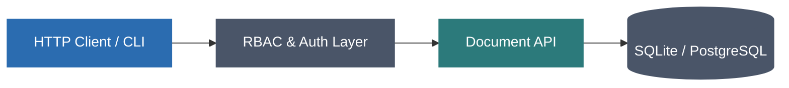
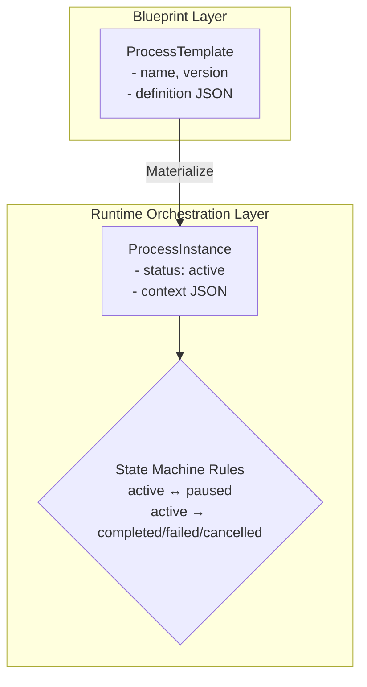
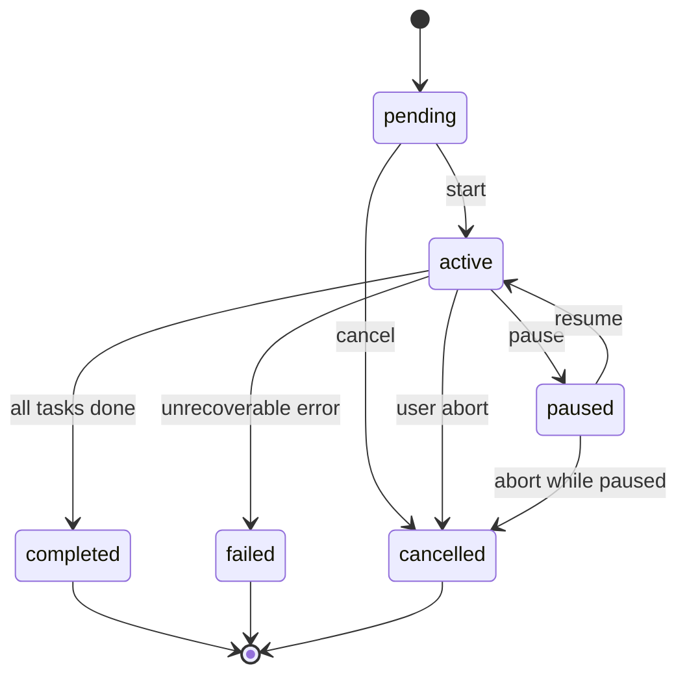
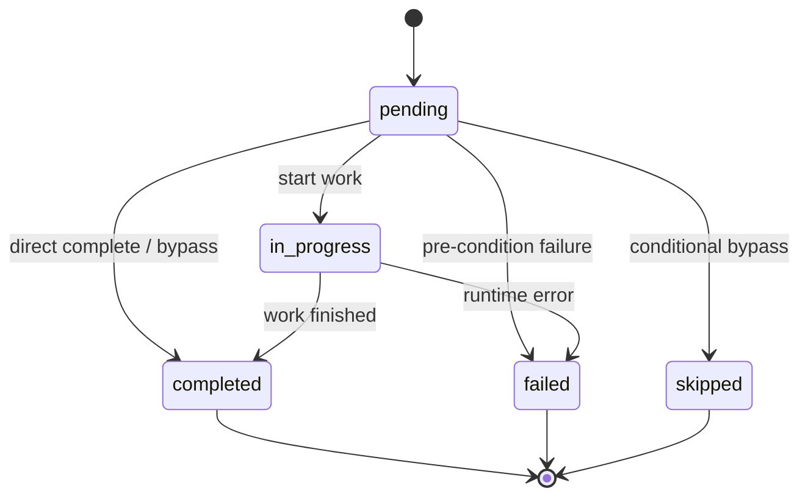
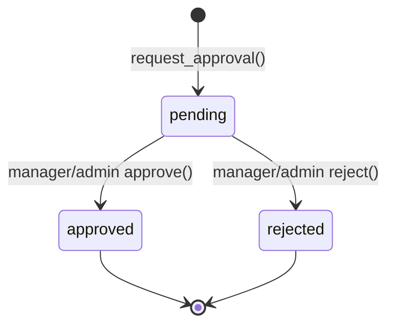

# Phase 5 System Design Evolution: Enterprise Process Orchestration & State Machine

## 1. Architectural Evolution

### Initial Starting Point (Early Phase 5)
At the start of Phase 5, the LakEnterprises platform had robust identity access (Phase 3) and document ingestion/search pipelines (Phase 4), but all actions were ad-hoc single-step HTTP calls. There was no mechanism to organize multi-step work into orchestrated workflows, track long-running task progress, or gate risky actions with human sign-offs.



---

### Intermediate Phase (P5-1 & P5-2: Blueprint Templates & State Machine)
The architecture introduced templates and execution instances governed by a strict, deterministic Finite State Machine (FSM).



---

### Advanced Target Design (End of Phase 5: Complete Enterprise Process Platform)
At the completion of Phase 5, the system integrates template management, runtime task tracking, human-in-the-loop approval gating, and role-based API access controls.

```mermaid
flowchart TD
    Client[FastAPI Client / CLI Command] -->|Bearer JWT| RBAC[RBAC Middleware: viewer / analyst / manager / admin]

    subgraph API Router Layer
        ProcRouter[/api/v1/processes]
        ApprRouter[/api/v1/approvals]
    end

    RBAC --> ProcRouter
    RBAC --> ApprRouter

    subgraph Business Service Layer
        PS[ProcessService\n- create_template\n- start_process\n- transition_instance\n- update_task]
        AS[ApprovalService\n- request_approval\n- approve\n- reject]
        FSMValidation{FSM Transition Engine\nIllegal transitions rejected}
    end

    ProcRouter --> PS
    ApprRouter --> AS
    PS --> FSMValidation

    subgraph Persistence Layer
        RepoTpl[ProcessTemplateRepository]
        RepoInst[ProcessInstanceRepository]
        RepoTask[ProcessTaskRepository]
        RepoAppr[ApprovalRequestRepository]
        SQL[(Relational Database\nprocess_template\nprocess_instance\nprocess_task\napproval_request)]
    end

    PS --> RepoTpl
    PS --> RepoInst
    PS --> RepoTask
    AS --> RepoAppr

    RepoTpl --> SQL
    RepoInst --> SQL
    RepoTask --> SQL
    RepoAppr --> SQL
```

---

## 2. State Machine Transition Specifications

### ProcessInstance Lifecycle FSM


### ProcessTask Lifecycle FSM


### Approval Request Lifecycle FSM


---

## 3. Subtask Breakdown Architecture
- **P5-1 (Template CRUD):** Blueprint schema with version tracking, active flags, and JSON validation for steps.
- **P5-2 (Instance & State Machine):** Dynamic instance creation, context dictionaries, and strict transition guards preventing terminal state mutation.
- **P5-3 (Task & Approval API):** Materialization of template steps into granular task entities, human-in-the-loop approval gates, and RBAC endpoint protection (`manager`/`admin` required for approval decisions).
- **P5-4 (CLI & Demo Runner):** Rich CLI interface (`list`, `start`, `status`, `run-demo`) enabling scripted automation and end-to-end demonstrations.
