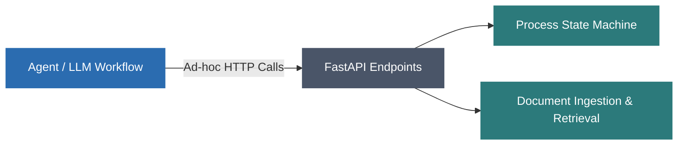
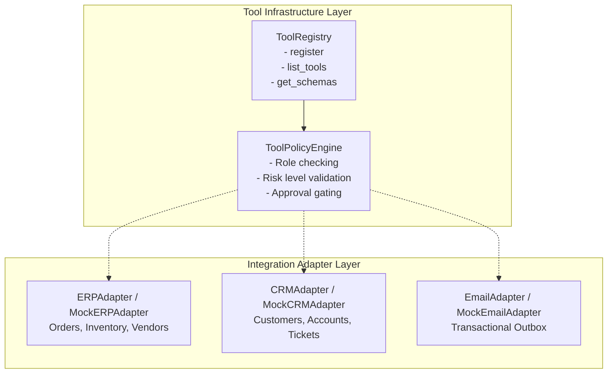
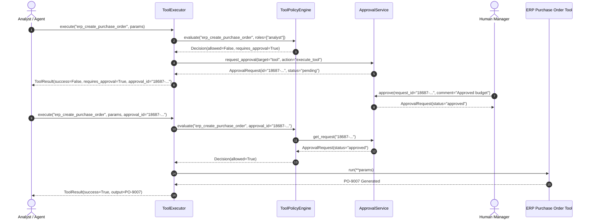

# Phase 6 System Design Evolution: Agent Tools & Enterprise Integrations

## 1. Architectural Evolution

### Initial Starting Point (Early Phase 6)
At the completion of Phase 5, the system possessed identity access control (Phase 3), document retrieval (Phase 4), and process state machines (Phase 5). However, any external action or inspection had to be performed via bespoke REST endpoints or manual operator interventions. There was no unified abstraction for agent tool discovery, parameter schema generation, risk tiering, or policy-governed tool execution.



---

### Intermediate Phase (P6-1 & P6-4: Registry, Policy Engine & Mock Integrations)
In the intermediate stage, the system introduced a centralized `ToolRegistry` and `ToolPolicyEngine`, accompanied by decoupled enterprise integration adapters (`ERPAdapter`, `CRMAdapter`, `EmailAdapter`) built on Python Protocols.



---

### Advanced Target Design (End of Phase 6: Complete Agent Tools & Integration Subsystem)
At the end of Phase 6, the system features a unified `ToolExecutor` that sits between agents (or REST clients) and enterprise tools. Read-only and write tools are cataloged with strict risk tiers. Write tools requiring human sign-off automatically trigger pending `ApprovalRequest` entities in the database, halting unapproved mutations until authorized managers approve the transaction.

```mermaid
flowchart TD
    Client[Agent / HTTP Client / CLI] -->|Execute Tool Request| Router[/api/v1/tools/{name}/execute]
    Router --> Auth[Auth & RBAC Middleware: Bearer JWT]
    Auth --> Executor[ToolExecutor]

    subgraph Governance & Policy Core
        Executor --> Registry[ToolRegistry: 12 Registered Tools]
        Executor --> Policy[ToolPolicyEngine]
        Policy --> Audit[AuditService: Immutable Logging]
        Policy --> ApprovalGate{Approval Required?}
    end

    ApprovalGate -->|No Approval Token| AutoAppr[ApprovalService: Create Pending Request]
    AutoAppr --> DB[(Relational DB: approval_request)]
    ApprovalGate -->|Token Verified & Approved| Dispatcher{Tool Category Dispatcher}

    subgraph Read-Only Tools: P6-2
        Dispatcher --> T1[document_search]
        Dispatcher --> T2[crm_customer_lookup]
        Dispatcher --> T3[crm_ticket_lookup]
        Dispatcher --> T4[erp_order_lookup]
        Dispatcher --> T5[erp_inventory_lookup]
        Dispatcher --> T6[process_status_lookup]
        Dispatcher --> T7[knowledge_graph_lookup]
    end

    subgraph Approval-Gated Write Tools: P6-3
        Dispatcher --> W1[crm_update_ticket]
        Dispatcher --> W2[erp_create_purchase_order]
        Dispatcher --> W3[email_dispatch]
        Dispatcher --> W4[process_task_submit]
        Dispatcher --> W5[approval_decision]
    end

    subgraph Enterprise Integration Adapters: P6-4
        T2 & T3 & W1 --> CRMAdapter[MockCRMAdapter: Customers & Tickets]
        T4 & T5 & W2 --> ERPAdapter[MockERPAdapter: Orders & Inventory]
        W3 --> EmailAdapter[MockEmailAdapter: Outbox Queue]
        T1 --> DocService[DocumentService: Hybrid Retriever]
        T6 & W4 --> ProcessService[ProcessService: State Machine]
        W5 --> ApprService[ApprovalService: Sign-offs]
    end
```

---

## 2. Tool Classification & Risk Policy Matrix

| Tool Name | Category | Risk Level | Requires Approval | Allowed Roles | System Target |
|-----------|----------|------------|-------------------|---------------|---------------|
| `document_search` | `READ` | `LOW` | No | All (Viewer, Analyst, Manager, Admin) | Knowledge Base / Vector Store |
| `crm_customer_lookup` | `READ` | `LOW` | No | All | CRM Adapter |
| `crm_ticket_lookup` | `READ` | `LOW` | No | All | CRM Adapter |
| `erp_order_lookup` | `READ` | `LOW` | No | All | ERP Adapter |
| `erp_inventory_lookup` | `READ` | `LOW` | No | All | ERP Adapter |
| `process_status_lookup` | `READ` | `LOW` | No | All | Process Service |
| `knowledge_graph_lookup` | `READ` | `LOW` | No | All | Knowledge Graph |
| `crm_update_ticket` | `WRITE` | `MEDIUM` | No | Analyst, Manager, Admin | CRM Adapter |
| `email_dispatch` | `ACTION` | `MEDIUM` | No | Analyst, Manager, Admin | Email Outbox |
| `process_task_submit` | `WRITE` | `LOW` | No | Analyst, Manager, Admin | Process Service |
| `erp_create_purchase_order` | `WRITE` | `HIGH` | **Yes** | Analyst, Manager, Admin | ERP Adapter |
| `approval_decision` | `ACTION` | `HIGH` | No (Self-governed) | Manager, Admin | Approval Service |

---

## 3. Human-In-The-Loop Approval Gating Flowchart


