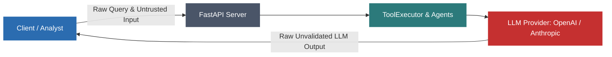
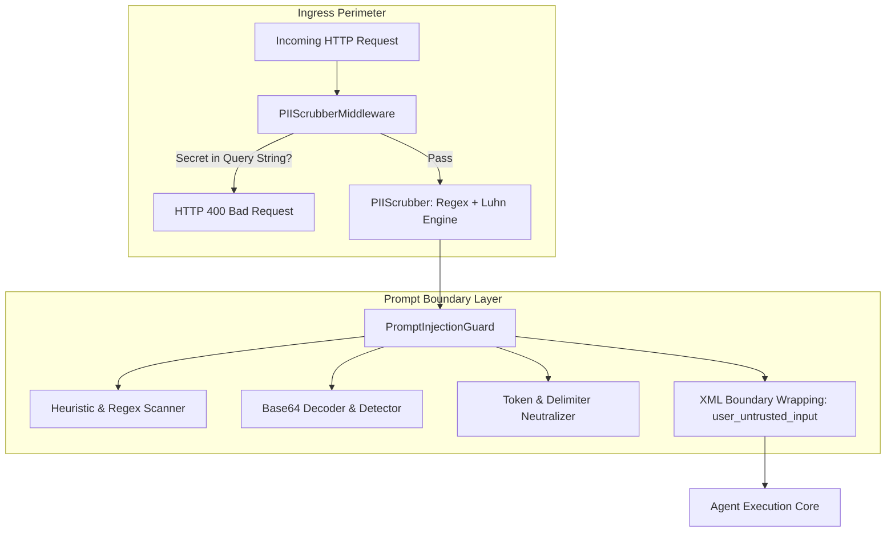
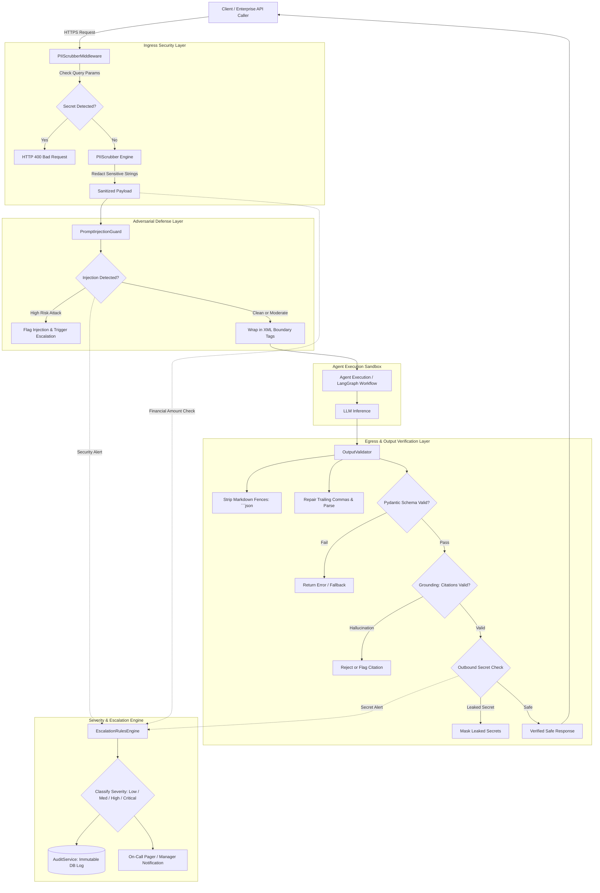

# Phase 7 System Design Evolution: Guardrails & Enterprise Security

## 1. Architectural Evolution

### Initial Starting Point (Early Phase 7)
At the end of Phase 6, the LakEnterprises platform had an operational tool ecosystem with role-based policies and human-in-the-loop approvals. However, the system assumed that incoming user queries and prompt payloads were well-intentioned and safe. There was no defense against prompt injection, jailbreaking, PII leaks, credential exfiltration, JSON formatting failures, or hallucinated citations.

**Vulnerabilities in Initial State:**
1. **Plaintext Secrets & PII:** API keys or credit cards passed in query parameters were processed and logged in plaintext.
2. **Prompt Injection:** An adversary could supply `"Ignore all previous instructions..."` or fake system delimiters (`<system>`, `[INST]`), causing the LLM to disobey enterprise constraints.
3. **Malformed Output & Hallucinations:** LLMs returning markdown wrappers or fictitious citations caused downstream API failures or ungrounded responses.
4. **Lack of Automated Threat Escalation:** High-risk financial requests and security anomalies required manual discovery.

---

### Intermediate Evolution (Subtasks P7-1 & P7-2: Ingress Protection & Prompt Guarding)
In the first half of Phase 7, we introduced an ingress perimeter defense: `PIIScrubberMiddleware` and `PromptInjectionGuard`.

- **P7-1:** Implemented regex patterns for AWS, OpenAI, JWT, RSA private keys, DB passwords, Luhn credit cards, SSNs, and emails. Recursive dictionary scrubbing cleans JSON payloads in place.
- **P7-2:** Implemented detection of instruction overrides, roleplay jailbreaks (DAN), system prompt leakage probes, token delimiters, and base64 payloads, with safe boundary tagging.

---

### Advanced Target Design (End of Phase 7: Complete End-to-End Guardrails Architecture)
At the completion of Phase 7, the system features a comprehensive, bidirectional security pipeline spanning ingress middleware, prompt sanitization, execution sandboxing, output verification, and automated severity escalation.

---

## 2. Subtask Breakdown & Implementation Details

| Subtask | Component | Purpose | Key Patterns / Algorithms |
|---|---|---|---|
| **P7-1** | `PIIScrubber` & `PIIScrubberMiddleware` | Redacts secrets and PII from strings, nested dicts, and HTTP queries | Luhn Checksum algorithm for credit cards; regex matching for AWS keys, OpenAI tokens (`sk-...`), RSA private keys, DB passwords; recursive dictionary traversal. |
| **P7-2** | `PromptInjectionGuard` | Detects adversarial jailbreaks, system prompt theft, and delimiter attacks | Multi-pattern regex heuristics (`OVERRIDE_INSTRUCTIONS`, `ROLEPLAY_JAILBREAK`, `SYSTEM_PROMPT_LEAK`), Base64 payload decoding and scanning, XML boundary containment. |
| **P7-3** | `OutputValidator` | Enforces structured schemas, repairs broken JSON, and validates citations | Regex code fence removal, trailing comma sanitization, Pydantic type validation, citation grounding set-intersection checks, egress secret scanning. |
| **P7-4** | `EscalationRulesEngine` | Classifies events by business and security risk, triggering audit logs and pagers | Multi-criteria deterministic rule engine; financial tier gating ($10,000 / $100,000), security threat tagging, role targeting, and audit integration. |

---

## 3. Design Patterns Applied

1. **Defense-in-Depth Pattern:** Security is enforced at ingress (middleware), before inference (prompt guard), after inference (output validator), and across operations (escalation engine).
2. **Pipeline Pattern:** Clean separation of concerns where each guardrail acts as an independent, composable filter stage.
3. **Fail-Closed Security Pattern:** Ingress queries containing secrets are immediately rejected with HTTP 400 rather than silently forwarded.
4. **Boundary Delimitation Pattern:** Untrusted user input is explicitly encapsulated within `<user_untrusted_input>` XML tags to prevent context bleed into system instructions.
5. **Robustness Principle (Postel's Law):** The `OutputValidator` is conservative in what it produces but liberal in what it accepts (automatically fixing markdown blocks and trailing commas from LLMs).
