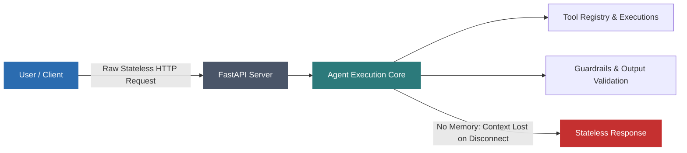
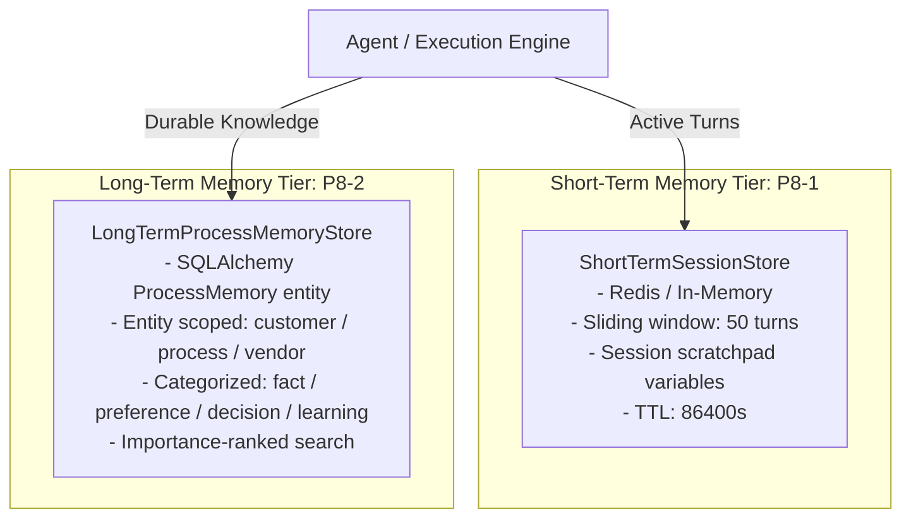
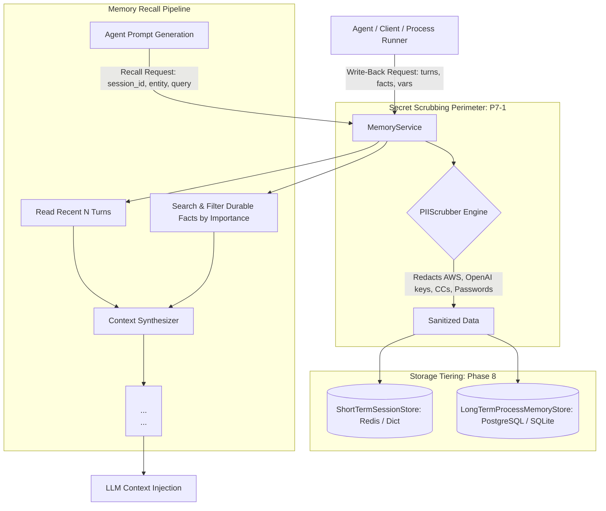

# Phase 8 System Design Evolution: Enterprise Memory

## 1. Architectural Evolution

### Initial Starting Point (Early Phase 8)
At the conclusion of Phase 7, the platform had identity control, document search, process state machines, tool governance, and guardrails. However, the system was fundamentally **stateless** across distinct interactions. Every session had to re-transmit previous dialogue or rely on ad-hoc query string parameters. There was no mechanism to remember facts, customer preferences, or process lessons across sessions.

---

### Intermediate Evolution (Subtasks P8-1 & P8-2: Dual Storage Engines)
In the intermediate stage of Phase 8, we introduced separate storage systems for short-term and long-term memory:
1. `ShortTermSessionStore`: Backed by Redis with in-memory fallback for conversational sliding windows and scratchpad variables.
2. `LongTermProcessMemoryStore`: Backed by SQLAlchemy `ProcessMemory` entities for permanent entity facts and learnings.

---

### Advanced Target Design (End of Phase 8: Unified Memory Orchestration & Scrubbed Recall)
At the completion of Phase 8, the memory subsystem integrates directly with Phase 7's `PIIScrubber` to enforce **zero-secret memory persistence**, and provides a unified `MemoryService` that synthesizes structured memory context (`<enterprise_memory>`) ready for LLM prompt injection.

---

## 2. Subtask Breakdown & Implementation Details

| Subtask | Component | Purpose | Key Patterns / Algorithms |
|---|---|---|---|
| **P8-1** | `ShortTermSessionStore` | High-throughput conversational turns and working memory | Redis lists (`RPUSH`, `LRANGE`), hashes for variables, pipeline transactions with TTL expiration, in-memory fallback, sliding-window truncation. |
| **P8-2** | `ProcessMemory` & `LongTermProcessMemoryStore` | Durable cross-process knowledge persistence | SQLAlchemy ORM entity (`process_memory`), upsert idempotency on `(entity_type, entity_id, key)`, importance-weighted indexing, keyword substring search. |
| **P8-3** | `MemoryService` & Routes | Orchestration of recall and write-back with PII protection | Integration with `PIIScrubber`, recursive dictionary scrubbing, XML prompt block synthesis (`<enterprise_memory>`), FastAPI router under `/api/v1/memory`. |

---

## 3. Design Patterns Applied

1. **Cache-Aside & Transparent Fallback Pattern:** The session store attempts Redis connection; if Redis is unreachable or unconfigured, it transparently falls back to an in-memory dictionary without failing the application.
2. **Repository Pattern:** `ProcessMemoryRepository` abstracts SQL operations (`create`, `upsert`, `get_by_key`, `search`, `delete_by_entity`) away from memory business logic.
3. **Defense-in-Depth / Sanitized Storage Pattern:** Memory stores never persist unscrubbed customer inputs; the `MemoryService` enforces `PIIScrubber` before writing to Redis or SQL.
4. **Context Injection Pattern:** On recall, short-term conversational turns and long-term facts are synthesized into a normalized, structured XML block (`<enterprise_memory>`) optimized for LLM attention.
