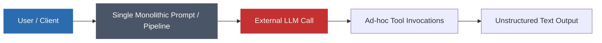
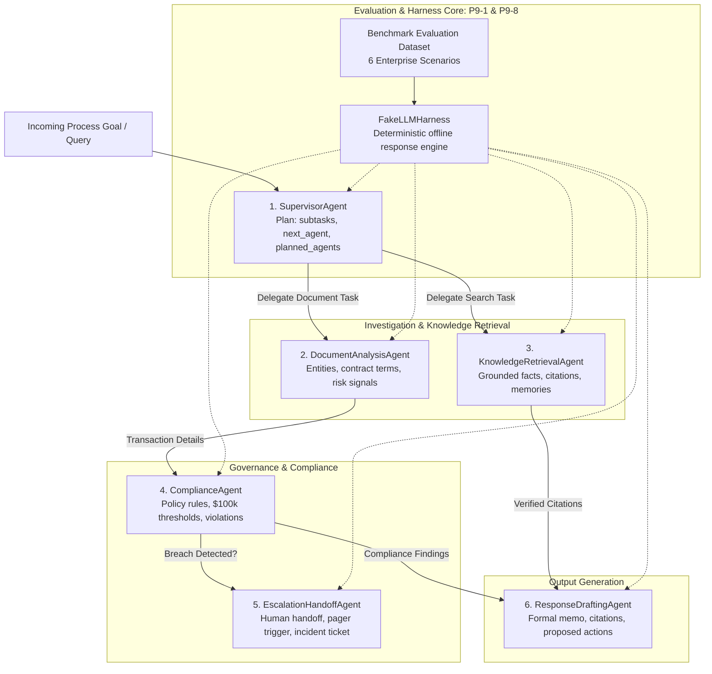

# Phase 9 System Design Evolution: Specialist Agents

## 1. Architectural Evolution

### Initial Starting Point (Early Phase 9)
At the conclusion of Phase 8, the LakEnterprises platform possessed document retrieval (Phase 4), process task persistence (Phase 5), tool execution (Phase 6), security guardrails (Phase 7), and enterprise memory (Phase 8). However, agent execution relied on single monolithic prompts or simple sequential steps. There was no role-specialized agent team, no typed agent contracts, and no benchmark harness for evaluating agent decision quality.



**Limitations of Initial State:**
1. **Unbounded Task Scope:** A single model turn was expected to parse documents, audit legal compliance, check historical memories, draft replies, and evaluate escalation risks simultaneously.
2. **Schema Drift:** Outputs lacked guaranteed Pydantic structures for downstream process state machine integration.
3. **Expensive Testing:** Running automated integration tests required live LLM tokens or unstable mock patches.

---

### Intermediate Evolution (Subtasks P9-1 through P9-4: Contracts, Harness, and Analytical Agents)
In the intermediate stage, we established a typed foundation with `AgentRole`, `AgentTask`, `AgentResult`, and the offline `FakeLLMHarness`, followed by the first core analytical specialists: `SupervisorAgent`, `DocumentAnalysisAgent`, and `ComplianceAgent`.

```mermaid
flowchart TD
    subgraph Foundation Layer: P9-1
        Schemas[Pydantic Schemas: AgentTask & AgentResult]
        Harness[FakeLLMHarness: Deterministic Mock Responses]
        Base[BaseSpecialistAgent Generic Base]
    end

    subgraph Analytical Specialists: P9-2, P9-3, P9-4
        Sup[SupervisorAgent\nWorkflow Decomposition & Planning]
        DA[DocumentAnalysisAgent\nEntity & Clause Extraction]
        Comp[ComplianceAgent\nPolicy & Threshold Auditing]
    end

    Schemas --> Base
    Harness --> Base
    Base --> Sup
    Base --> DA
    Base --> Comp
```

---

### Advanced Target Design (End of Phase 9: Complete Specialist Agent Team & Evaluation Suite)
At the completion of Phase 9, the system features a complete roster of 6 specialized agents operating over standardized Pydantic schemas, supported by a benchmark evaluation dataset (`P9-8`) with 100% automated scenario coverage.



---

## 2. Subtask Breakdown & Implementation Details

| Subtask | Component | Purpose | Key Patterns / Schemas |
|---|---|---|---|
| **P9-1** | `AgentRole`, `AgentTask`, `AgentResult`, `FakeLLMHarness` | Strongly typed agent contracts and offline execution harness | Generic Pydantic `BaseSpecialistAgent[T]`, role-based prompt synthesis, latency tracking, custom mock response registration. |
| **P9-2** | `SupervisorAgent` | Goal decomposition and specialist routing | `SupervisorPlan`: planned subtasks, next agent recommendation, completion flag. |
| **P9-3** | `DocumentAnalysisAgent` | Entity, clause, and risk extraction from documents | `DocumentAnalysisResult`: key findings, extracted entities (vendor, amount), risk signals, confidence score. |
| **P9-4** | `ComplianceAgent` | Corporate policy and financial limit auditing | `ComplianceResult`: `is_compliant`, `ComplianceViolation` list, rule IDs (`POL-FIN-100K`), risk tier. |
| **P9-5** | `KnowledgeRetrievalAgent` | Multi-source factual evidence retrieval | `KnowledgeRetrievalResult`: grounded facts, relevance scores, verified citation IDs (`KB-PROC-01`). |
| **P9-6** | `ResponseDraftingAgent` | Formal customer and partner communication generation | `ResponseDraftResult`: tone constraints, key points, proposed actions, citation embedding. |
| **P9-7** | `EscalationHandoffAgent` | Human-in-the-loop escalation and incident routing | `EscalationHandoffResult`: `requires_human`, `severity`, `target_role`, incident ticket generation (`INC-7701`). |
| **P9-8** | `BENCHMARK_SCENARIOS` & `evaluate_scenario()` | Automated regression and accuracy evaluation dataset | 6 multi-domain scenarios verifying compliance, citation grounding, entity extraction, and handoff rules. |

---

## 3. Design Patterns Applied

1. **Role-Based Specialization Pattern:** Rather than forcing a single prompt to solve everything, distinct specialist agents own specific domain logic and output schemas.
2. **Generic Template Method Pattern:** `BaseSpecialistAgent[T]` defines the common lifecycle: prompt assembly $\rightarrow$ LLM generation $\rightarrow$ schema validation $\rightarrow$ latency metric capture.
3. **Test Double / Offline Harness Pattern:** `FakeLLMHarness` decouples development, CI/CD, and regression tests from live cloud LLM dependencies, running test suites in under 1 second.
4. **Separation of Concerns:** Investigation (`DocumentAnalysisAgent`, `KnowledgeRetrievalAgent`), governance (`ComplianceAgent`, `EscalationHandoffAgent`), and action (`ResponseDraftingAgent`) are cleanly partitioned.
