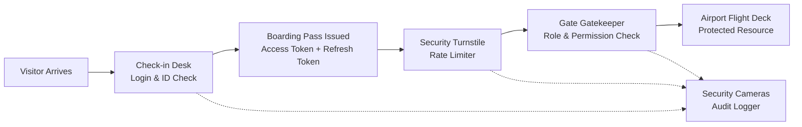

# Phase 3 — Identity and Access Control: Plain-English Guide

> **Target Audience:** Recruiters, Hiring Managers, Non-Technical Executives, and System Stakeholders.  
> **Purpose:** Explain the security, identity, and access control layer built in Phase 3 without unnecessary technical jargon.

---

## 1. What Problem Did Phase 3 Solve?

Imagine walking into a large corporate skyscraper or a high-security airport. 

If there were no security desk:
- Anyone could walk in off the street.
- Anyone could enter the CEO's office or the air traffic control room.
- A malicious person could repeatedly run through the front revolving door thousands of times per second, clogging the lobby so legitimate people cannot enter.
- If important company files went missing, nobody would know who entered the room or when.

In our software platform (**LakEnterprises**), **Phase 3: Identity and Access Control** is the digital security department that solves all of these problems. It guarantees:
1. **Authentication ("Who are you?"):** Proving that a user is who they claim to be.
2. **Authorization ("What are you allowed to do?"):** Ensuring viewers can only read public data, while only administrators can manage users or change system settings.
3. **Rate Limiting ("Don't flood the lobby"):** Preventing automated bots or malicious scripts from overwhelming our servers.
4. **Audit Logging ("The Security Camera"):** Keeping an indelible black-box log of every sensitive action, login attempt, or rejection for compliance and safety.

---

## 2. The Airport Analogy: How the System Works

To easily picture how our code works, think of a modern international airport:

### Step 1: The Check-in Desk (`/login` & Password Hashing)
- When a user arrives, they provide their username and password.
- **How we protect passwords:** We never save actual passwords in plain text. Instead, we use a cryptographic recipe (PBKDF2/Bcrypt) combined with a secret unique seasoning (called a "salt"). Even if someone broke into the database, they would only see a scrambled, irreversible string of letters and numbers.
- Once verified, the desk issues **two digital passes**:
  1. **An Access Token (The Boarding Pass):** A temporary pass (valid for 60 minutes) containing your identity and your assigned privileges.
  2. **A Refresh Token (The Claim Ticket):** A longer-lived ticket (valid for 7 days) stored securely to get a new boarding pass when the old one expires, so you don't have to re-enter your password every hour.

### Step 2: The Security Turnstile (Rate Limiting)
- Before anyone can access our services, they must pass through an automated turnstile.
- If a person or automated bot attempts to make 100 requests in 10 seconds, the turnstile detects the spike and politely says: *"Hold on, you are moving too fast. Please wait 30 seconds."* (HTTP status code `429: Too Many Requests`).
- This protects our system from Denial-of-Service (DoS) attacks and prevents server crashes.

### Step 3: The Boarding Gate (Role-Based Access Control - RBAC)
- Different areas of the enterprise have different clearance levels:
  - **Viewer:** Can look at basic documents (like passengers in the departure lounge).
  - **Analyst:** Can run research queries and view summaries (like flight attendants reviewing manifests).
  - **Manager / Auditor:** Can review processes and inspect logs (like safety inspectors).
  - **Admin:** Has full access to configure the platform and manage employees (like the airport director).
- When a user tries to access a protected area, our guard decorator checks their digital badge. If they don't have the required role or permission, access is immediately blocked (`403: Forbidden`).

### Step 4: The Black-Box Security Camera (Audit Middleware)
- In aviation and enterprise finance, every single flight maneuver and badge scan is recorded.
- Every time a user makes a request, our **Audit Middleware**:
  1. Assigns a unique tracking number (`X-Request-ID`) so we can trace the exact journey of that request.
  2. Measures how long the request took to process.
  3. Records who made the request, their IP address, what action they took, and whether it succeeded or failed.
- If an auditor arrives months later asking, *"Who changed this setting on November 15th at 3:00 PM?"*, the company has a verified, non-repudiable audit trail.

---

## 3. Key Components Built in Phase 3

| Component | Everyday Real-World Name | What It Does |
|-----------|--------------------------|--------------|
| **`AuthService`** | The ID Card Printing Office | Creates, signs, validates, and revokes digital keys (JWT tokens). |
| **`RBAC Decorator & Dependencies`** | The Security Guard at the Door | Inspects the caller's badge to verify they have permission before letting them into an endpoint. |
| **`RateLimitMiddleware`** | The Traffic Cop / Metering Gate | Uses high-speed memory (Redis) to count requests per minute and stop spam or abusive traffic. |
| **`AuditMiddleware`** | The Flight Data Recorder | Automatically stamps every request with a tracking ID and logs access records for security compliance. |
| **`Auth Routes`** | The Customer Service Counter | Web addresses (`/api/v1/auth/login`, `/refresh`, `/logout`, `/me`, `/demo-tokens`) where users interact with the security system. |

---

## 4. Why This Architecture Impresses Enterprise Clients

1. **Defense in Depth:** Security isn't just checked at the front door; it is verified at the network gate, the router layer, and inside individual business operations.
2. **Zero Plaintext Credentials:** Industry-standard cryptographic salting and hashing prevent catastrophic credential leaks.
3. **High Performance with Graceful Fallback:** If the external Redis caching system happens to restart, our rate limiter seamlessly falls back to local computer memory without dropping or breaking client requests.
4. **Instant Revocation:** If an employee leaves the company or a laptop is lost, their token can be revoked immediately, cutting off access in real time.
5. **Turnkey Demo Capabilities:** Includes demo endpoints (`/api/v1/auth/demo-tokens`) allowing recruiters and stakeholders to test the application instantly as a `viewer`, `analyst`, or `admin` without needing manual database setup.
