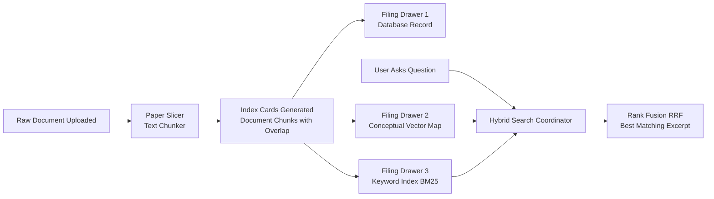

# Phase 4 — Document Processing Pipeline: Plain-English Guide

> **Target Audience:** Recruiters, Hiring Managers, Non-Technical Executives, and Stakeholders.  
> **Purpose:** Explain the document ingestion, chunking, vector storage, and hybrid search pipeline built in Phase 4 using simple, everyday analogies.

---

## 1. What Problem Did Phase 4 Solve?

Imagine an enterprise with thousands of 100-page policy manuals, legal contracts, technical specifications, and internal guides.

If an analyst needs an answer to: *"What is our data retention policy for closed accounts?"*, asking an AI to read all 1,000 documents from start to finish on every single question is:
- **Too slow:** Taking minutes or hours.
- **Too expensive:** Costing thousands of dollars in AI token fees.
- **Inaccurate:** Large Language Models get overwhelmed when fed hundreds of pages at once (the "needle in a haystack" problem).

In **Phase 4: Document Processing Pipeline**, we built the intelligent document indexing and search engine that solves this. It takes enterprise documents, breaks them down into digestible bite-sized cards, indexes them conceptually and by keyword, and retrieves the exact paragraph needed in milliseconds.

---

## 2. The Library Analogy: How the Pipeline Works

To picture how our code works, think of how a master librarian organizes a giant university library:

### Step 1: The Paper Slicer (Intelligent Chunking with Overlap)
- Instead of keeping a 50-page document as one giant block of text, our **Text Chunker** slices it into small, focused excerpts (about 500 characters or 100 words each).
- **The "Overlap" Secret:** When slicing text, if you cut a sentence in half between two pages, the meaning is lost. Our chunker keeps an intentional **overlap** (e.g., 50 characters) between consecutive cards. That way, the thought on the edge of card #1 is repeated at the start of card #2, preserving full context.
- **Boundary Awareness:** It never chops words in half; it respects natural paragraph and sentence endings.

### Step 2: The Two Filing Cabinets (Keyword vs Conceptual)
When someone searches for information, people search in two different ways:
1. **The Exact Word Search (BM25 Keyword Index):** Looking for specific codes, acronyms, or proper nouns (like "SOC2", "AES-256", or "Form 10-K").
2. **The Conceptual Meaning Search (Vector Store):** Looking for meaning even when words differ. For example, if you search *"how to fire an employee"*, it understands that a policy titled *"termination and separation procedures"* is a direct match, even though the word "fire" never appears in the text.

### Step 3: The Master Librarian (Reciprocal Rank Fusion - RRF)
- When a user asks a question, our system runs **both** searches simultaneously:
  - Vector search finds the top 5 conceptually relevant cards.
  - BM25 search finds the top 5 exact-keyword cards.
- Our **Hybrid Retriever** merges both result lists using a mathematical algorithm called **Reciprocal Rank Fusion (RRF)**. Cards that score high on *both* meaning and exact keywords bubble up to the very top.

### Step 4: Security and Destruction Gates (Role-Based Access)
- **Viewers:** Can search and read indexed documents.
- **Analysts:** Can upload and ingest new research manuals.
- **Admins Only:** Only administrators have permission to delete documents, preventing accidental loss of critical business knowledge.

---

## 3. Key Components Built in Phase 4

| Component | Everyday Real-World Name | What It Does |
|-----------|--------------------------|--------------|
| **`TextChunker`** | The Smart Paper Slicer | Cuts documents into overlapping, context-preserving text chunks. |
| **`InMemoryVectorStore`** | The Conceptual Map | Maps every chunk into multi-dimensional mathematical space to measure semantic similarity. |
| **`DeterministicFakeEmbeddings`** | The Offline Brain | Creates reproducible vector representations without needing paid third-party API keys or internet access. |
| **`HybridRetriever`** | The Master Searcher | Combines keyword matching and conceptual matching with mathematical rank fusion. |
| **`DocumentService`** | The General Manager | Coordinates the database, file readers, vector store, and search operations. |
| **`Document Routes`** | The Web Counter | REST API endpoints (`/api/v1/documents/ingest`, `/search`, `/{id}`) for user interfaces. |
| **CLI Ingest Command** | The Batch Scanner | Command-line tool (`lakenterprises ingest <folder>`) to load entire folders of documents at once. |

---

## 4. Why This Architecture Impresses Enterprise Clients

1. **Zero Hallucination Grounding:** AI answers in later phases will be strictly backed by direct citations to these verified chunks.
2. **Offline Resilience:** The entire vector and search pipeline runs completely offline with 0 external service dependencies, keeping company documents private and secure.
3. **Best of Both Worlds:** Pure keyword search misses synonyms; pure vector search misses exact part numbers. Hybrid RAG combines both for enterprise accuracy.
4. **Audit and Deletion Governance:** Ingestion and destructive actions are protected by enterprise role-based security.
