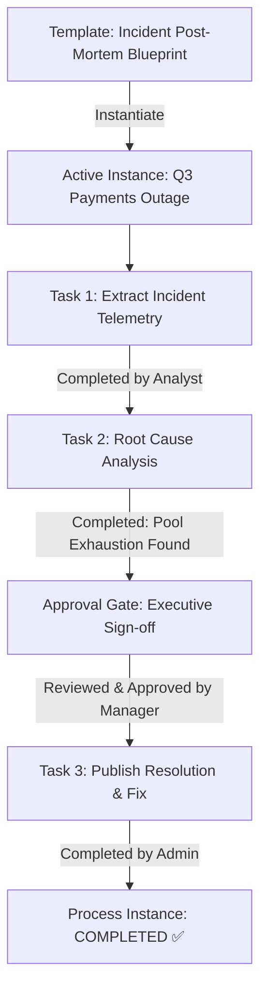

# Phase 5 Explained: Enterprise Process & Governance API in Plain English

## 1. What Problem Did Phase 5 Solve?
Imagine a large manufacturing plant or an airline. Before any airplane takes off or before an enterprise launches a major production deployment, you cannot simply let a single person or random AI script do whatever it wants in an uncontrolled manner. 

You need:
1. **A Standard Blueprint (Checklist):** Every time an incident or financial audit happens, specific, numbered steps must be executed in order.
2. **An Execution Tracker (Job Ticket):** When a specific incident occurs (e.g., "Payment Gateway Outage Q3"), a live ticket is stamped from that blueprint with a start state and progress tracker.
3. **Guardrails & State Machine:** You cannot jump directly from "Investigating" to "Resolved" without going through "Root Cause Verification". The process must forbid illegal shortcuts.
4. **Human Quality Control Gates (Approvals):** High-stakes steps (like modifying production billing or filing official audit reports) cannot be automated blindly—they require explicit sign-off from an authorized Manager or Admin.

Phase 5 built this exact digital assembly line into the LakEnterprises platform.

---

## 2. Key Components Explained Using Real-World Analogies

### A. Process Templates (`ProcessTemplate`): The Blueprint / Recipe
- **Real-World Analogy:** A printed culinary recipe or airline pre-flight checklist.
- **What it does:** Defines the steps of a business workflow, what order they follow, and which employee role (e.g., `analyst`, `manager`, `admin`) is expected to carry out each step.
- **Features:** Supports versioning (`v1`, `v2`), activation/deactivation toggles, and JSON step specifications.

### B. Process Instances (`ProcessInstance`): The Active Assembly Job
- **Real-World Analogy:** A car moving along the physical conveyor belt with a barcode attached to its chassis.
- **What it does:** Represents a live, executing instance of a template. It records the current lifecycle state (`pending` ➔ `active` ➔ `paused` ➔ `completed`/`failed`/`cancelled`) and carries runtime data (like incident details, timestamps, and findings).

### C. Process Tasks (`ProcessTask`): The Individual Work Stations
- **Real-World Analogy:** Station 1: Inspect engine. Station 2: Test brakes. Station 3: Final inspection stamp.
- **What it does:** When an instance starts, the platform automatically materializes individual database tasks for each step in the template. Each task has a position, status (`pending`, `in_progress`, `completed`, `skipped`, `failed`), and output storage.

### D. Approval Gateways (`ApprovalRequest`): The Manager Sign-off Stamp
- **Real-World Analogy:** The factory floor supervisor who must review inspection logs and physically sign the release manifest before the aircraft is cleared for taxiing.
- **What it does:** Enforces "human-in-the-loop" governance. Any high-risk operation triggers a formal approval record. Only users holding the `manager` or `admin` role can grant or reject the request, with audit comments recorded.

### E. The Process CLI (`python -m lakenterprises process ...`)
- **Real-World Analogy:** The dashboard control panel in the supervisor's office.
- **What it does:** Allows engineers, operators, or demonstration scripts to inspect templates, launch new workflows, view live task status, and run end-to-end simulated scenarios (`run-demo`).

---

## 3. How It All Works Together: The Q3 Outage Example

1. **Step 1:** The Incident Response team uses the `Incident Post-Mortem` template to spawn an instance.
2. **Step 2:** Tasks 1 and 2 are assigned to analysts who query telemetry and document the database pool exhaustion.
3. **Step 3:** The process hits the approval gate. It pauses automated resolution until a manager reviews the findings.
4. **Step 4:** The manager approves the remediation plan via `/api/v1/approvals/{id}/approve`.
5. **Step 5:** The final deployment task runs, and the overall process cleanly transitions to `completed`.

---

## 4. Key Takeaways for Interviewers & Leadership
- **Zero Ambiguity:** Strict state machines eliminate race conditions and illegal status jumps.
- **Built-in Compliance:** Every task progression and approval decision records timestamps, reviewer IDs, and explanations.
- **Separation of Concerns:** Analysts analyze; managers approve; admins govern. Roles are enforced at the API layer with HTTP 403 barriers.
