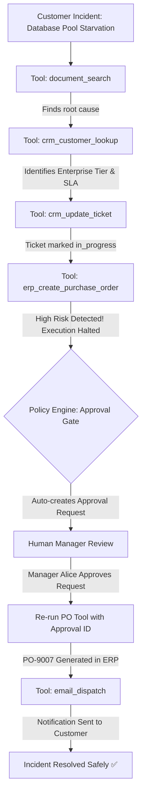

# Phase 6 Explained: Agent Tools & Enterprise Integrations in Plain English

## 1. What Problem Did Phase 6 Solve?
Imagine hiring an intelligent executive assistant. If all that assistant can do is talk, think, and generate text on a screen, they cannot actually fix problems for your company. To be truly useful, that assistant needs hands and safe tools:
1. They need to look up customer account records in Salesforce (CRM).
2. They need to check inventory and purchase orders in SAP or NetSuite (ERP).
3. They need to dispatch notification emails to incident response teams.
4. They need to query company knowledge base articles.

**The Danger:** If you simply give an AI assistant unfettered, direct access to your company's core databases, an accidental prompt or hallucination could overwrite customer records, leak private customer financial records, or place unauthorized multi-million dollar purchase orders.

**The Solution:** Phase 6 built an **enterprise-grade tool governance and integration system**. It equips agents with standard tools to interact with enterprise systems while placing strict safety belts, role checks, and human-in-the-loop approval gates around every high-stakes action.

---

## 2. Key Components Explained Using Real-World Analogies

### A. The Tool Registry (`ToolRegistry`): The Certified Tool Shed
- **Real-World Analogy:** A secure, organized tool shed on a construction site. Every tool (drill, hammer, crane, scanner) has an official tag, safety manual, and operating license requirement.
- **What it does:** Central catalog of all actions available to AI agents. It describes what each tool does, its category (`read`, `write`, `action`), its risk level (`low`, `medium`, `high`, `critical`), and auto-generates OpenAI/LangChain-compatible schemas so LLMs know how to invoke them properly.

### B. The Policy Engine (`ToolPolicyEngine`): The Site Security Officer
- **Real-World Analogy:** A security officer posted at the tool shed door checking employee badges.
- **What it does:** Intercepts every single tool call before execution:
  - **Viewer Badge:** Can only borrow magnifying glasses (`READ` tools with `LOW` risk like `document_search` or `crm_customer_lookup`).
  - **Analyst Badge:** Can read across systems and run everyday write tools, but cannot execute high-risk financial or destructive tools without management sign-off.
  - **Manager & Admin Badges:** Can authorize, review, and execute high-risk operations.

### C. Approval-Gated Tools: The Two-Key Nuclear Launch Box
- **Real-World Analogy:** Two executives turning separate keys to authorize an expensive wire transfer.
- **What it does:** When an agent tries to place an enterprise purchase order (`erp_create_purchase_order`), the system halts execution, creates a formal `ApprovalRequest` in the database, and alerts a human manager. Only when an authorized manager approves the ticket can the tool actually execute.

### D. Mock Enterprise Adapters (`MockERPAdapter`, `MockCRMAdapter`, `MockEmailAdapter`): The Flight Simulator
- **Real-World Analogy:** A realistic flight simulator used to train pilots before they touch a commercial airliner.
- **What it does:** Emulates production ERP (purchase orders, warehouse stock), CRM (customer accounts, support tickets), and Email systems with pre-loaded enterprise data, deterministic responses, and outage simulation for testing without touching live production infrastructure or incurring cloud API bills.

---

## 3. How It All Works Together: The Emergency Server Replacement Story

Here is how an agent safely resolves a real-world enterprise incident using Phase 6 tools:

1. **Investigation:** The agent searches technical documentation (`document_search`) to confirm that database connection starvation requires deploying an additional compute rack node.
2. **Impact Assessment:** The agent queries the CRM (`crm_customer_lookup`) to retrieve Acme Global's enterprise tier and gold SLA terms.
3. **Status Update:** The agent updates the support ticket status (`crm_update_ticket`) to let the customer know investigation is actively underway.
4. **Procurement Gate:** The agent requests a new compute node purchase order (`erp_create_purchase_order`). Because this is high-risk ($18,000 order), the **Policy Engine** halts execution and generates a pending approval request.
5. **Human Sign-Off:** Manager Alice inspects the purchase order details and approves the request (`approval_decision`).
6. **Execution & Communication:** The purchase order is executed, and an automated resolution email is dispatched to the customer (`email_dispatch`).

---

## 4. Key Takeaways for Non-Technical Leaders & Recruiters
- **Safety by Default:** Agents are never given unchecked write access. High-impact operations must pass automated role policies and human review gates.
- **Plug-and-Play Architecture:** The integration layer uses standard Python Protocols. Swapping our mock ERP for live SAP or Salesforce requires changing only the adapter, with zero changes to agent logic.
- **Total Auditability:** Every tool invocation, parameter payload, latency measurement, and policy decision is permanently recorded in the immutable audit log.
