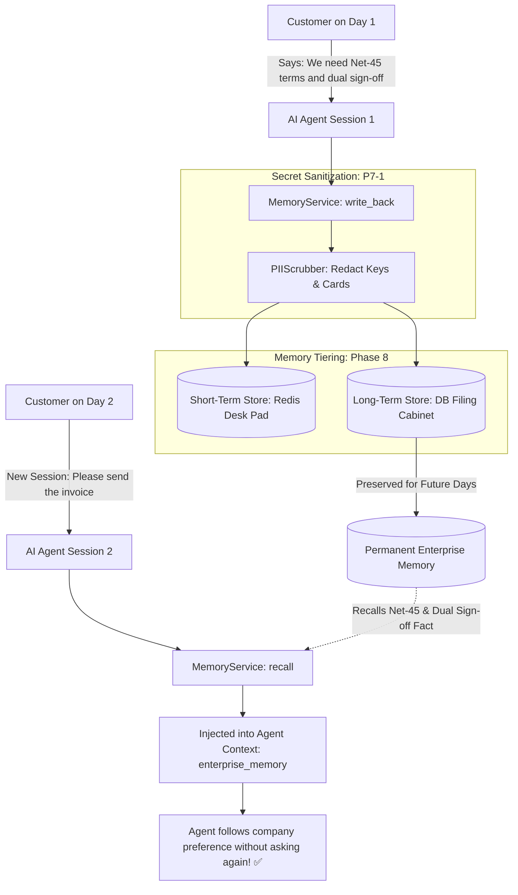

# Phase 8 Explained: Enterprise Memory in Plain English

## 1. What Problem Did Phase 8 Solve?

Imagine hiring an incredibly talented corporate consultant who suffers from extreme short-term amnesia:
1. **The Forgetful Colleague:** Every time you hang up the phone or refresh your browser, they completely forget who you are, what you talked about 5 minutes ago, and what decisions were just agreed upon.
2. **The Groundhog Day Nightmare:** When a customer calls on Monday to say, *"Our corporate policy strictly requires PO approval and Net-45 payment terms"*, and then calls back on Wednesday, the consultant asks the exact same basic questions all over again.
3. **The Leaky Blackboard:** If the consultant scribbles down an executive's secret API key or personal credit card on an unprotected whiteboard to "remember" it, any intruder can steal the credentials.

**The Solution:** Phase 8 built a two-tier **Enterprise Memory Subsystem** that functions like human memory:
- **Short-Term Memory (The Working Desk & Sticky Notes):** Powered by Redis, this maintains fast, real-time conversational context and working variables while you are talking with the AI.
- **Long-Term Memory (The Filing Cabinet & Corporate Archive):** Powered by our relational database, this stores durable business facts, customer preferences, past process decisions, and learnings permanently across sessions.
- **Automated Memory Redaction:** Before anything is written onto the desk or into the filing cabinet, our Phase 7 security guardrails automatically redact passwords, API keys, and credit cards so secrets are never stored in memory.

---

## 2. Key Components Explained Using Real-World Analogies

### A. Short-Term Session Store (`ShortTermSessionStore`): The Active Desk Pad & Sticky Notes
- **Real-World Analogy:** A desk notepad where you jot down recent conversational turns and temporary variables (e.g. `current_order_id = 9001`, `customer_tier = Platinum`).
- **What it does:**
  - Fast, in-memory caching powered by **Redis** (with an automatic fallback to local memory if Redis is offline).
  - Keeps track of the active dialogue history between user and AI agent.
  - Automatically manages a sliding window (e.g. keeping the most recent 50 messages) and expires old inactive conversations after 24 hours so storage never gets clogged.

### B. Long-Term Process Memory Store (`LongTermProcessMemoryStore`): The Corporate Library & Filing Cabinet
- **Real-World Analogy:** A secure, fireproof filing cabinet where an organization archives company knowledge, customer policies, vendor discount agreements, and past incident post-mortems.
- **What it does:**
  - Persists structured facts and learnings in PostgreSQL / SQLite.
  - Organizes memories by entity (e.g. `customer:CUST-1001`, `vendor:VEND-202`, `process:PROC-505`).
  - Categorizes memories by type (`fact`, `preference`, `decision`, `summary`, `learning`) with an importance rating.
  - Allows agents to search across years of historical corporate experience.

### C. Memory Service (`MemoryService`): The Chief Knowledge Officer & Redaction Secretary
- **Real-World Analogy:** An executive secretary who sits between the desk pad and the permanent filing cabinet.
- **What it does:**
  - **Recall:** When an agent prepares to answer a query, the secretary pulls recent conversation notes and pulls relevant historical facts from the filing cabinet, preparing a clean executive summary block (`<enterprise_memory>`) for the AI.
  - **Write-Back with Secret Scrubbing:** When a conversation ends, the secretary reviews the notes with an indelible black marker. If the customer mentioned a credit card or AWS token, it is redacted before saving.

---

## 3. How It Works Together: The Enterprise Renewal Story

Here is how our memory subsystem works during a real corporate customer interaction:

1. **Day 1 Conversation:** Acme Global chats with our agent and specifies: *"We require PO approvals and Net-45 payment terms."* In passing, they also share an AWS test token.
2. **Safe Write-Back:** The `MemoryService` scrubs the AWS token into `[REDACTED_AWS_KEY]` and archives the payment preference into the durable long-term database under `customer:CUST-ACME`.
3. **Day 2 Follow-up:** Acme Global opens a completely new conversation asking to prepare an invoice.
4. **Context Recall:** The agent calls `recall()`. The memory service finds zero messages in the new session, but instantly recalls the permanent rule: *"Acme requires PO approval and Net-45 terms"*.
5. **Seamless Execution:** The agent immediately prepares the invoice according to Acme's terms without asking repetitive questions.

---

## 4. Key Takeaways for Non-Technical Leaders & Recruiters
- **Human-Like Memory Architecture:** Distinguishes between immediate short-term dialogue and permanent cross-process corporate knowledge.
- **Zero Secret Leaks:** Every memory item passes through automated PII/secret scrubbing before being stored, preventing credential leaks in caches or databases.
- **Continuous Learning:** The platform gets smarter over time by capturing business preferences, resolutions, and operational learnings.
