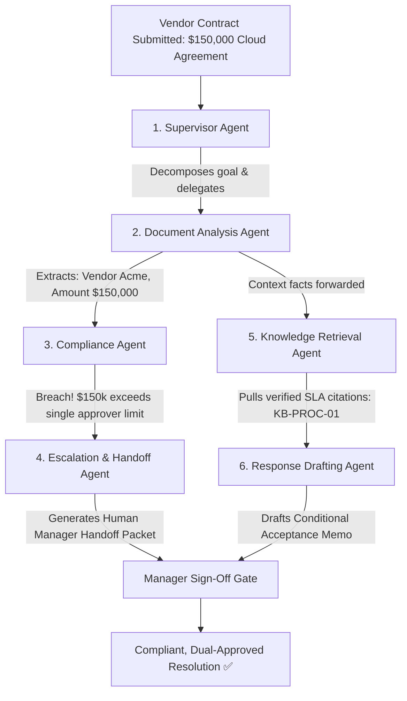

# Phase 9 Explained: Specialist Agents in Plain English

## 1. What Problem Did Phase 9 Solve?

Imagine walking into a large hospital or law firm where a single generalist tries to perform every single job alone:
1. **The Jack-of-all-Trades Trap:** That one person tries to perform brain surgery, audit the tax returns, inspect the fire alarms, draft legal contracts, and answer the customer service desk. Inevitably, they make catastrophic mistakes because no single generalist can master every nuance.
2. **Hallucinations & Guesswork:** When a monolithic AI is asked to do everything at once in a single prompt, it frequently cuts corners, mixes up financial thresholds, skips compliance rules, or invents facts.
3. **Lack of Accountable Roles:** In an enterprise, if something goes wrong, you need to know: Was it a contract extraction error? Did compliance fail to flag a \$100k cap? Did the drafter use an unapproved tone?

**The Solution:** Phase 9 introduced **Specialist Agents** — a team of 6 highly focused, role-based AI professionals coordinated by a central supervisor. Just like in a well-run corporation, each agent has one specific job, follows strict rules and checklists, produces structured data, and hands off their work to the next expert.

---

## 2. Key Components Explained Using Real-World Analogies

### A. Supervisor / Orchestrator Agent (`SupervisorAgent`): The Executive Project Manager
- **Real-World Analogy:** An experienced corporate chief of staff or project manager holding a clipboard.
- **What it does:**
  - Evaluates the customer's high-level request or corporate goal.
  - Decomposes the goal into step-by-step tasks.
  - Decides which specialist needs to work next (e.g. *"First, give the contract to the Document Analyst, then send findings to Compliance, then have the Drafter write the response"*).

### B. Document Analysis Agent (`DocumentAnalysisAgent`): The Senior Paralegal & Contract Reader
- **Real-World Analogy:** A sharp paralegal who reviews 80-page contracts with a highlighter.
- **What it does:**
  - Ingests raw contracts, purchase orders, or legal notes.
  - Extracts key entities (vendor names, dollar amounts, effective dates, payment terms).
  - Flags dangerous legal clauses, like missing liability limitations or excessive warranties.

### C. Compliance Check Agent (`ComplianceAgent`): The Corporate Compliance & Risk Officer
- **Real-World Analogy:** A strict corporate comptroller who ensures every rule in the company handbook is obeyed.
- **What it does:**
  - Checks transactions against corporate bylaws, financial limits (e.g. anything over \$100,000 requires executive approval), and security guidelines.
  - Issues a clear verdict: `is_compliant = True/False` with specific rule violation codes.

### D. Knowledge Retrieval Agent (`KnowledgeRetrievalAgent`): The Research Librarian & Fact Checker
- **Real-World Analogy:** A senior research librarian who instantly pulls exact references from policy archives, CRM records, and customer history.
- **What it does:**
  - Queries company knowledge bases and past enterprise memories (Phase 8).
  - Retrieves grounded facts with exact citation tags (`KB-PROC-01`, `CRM-ACME-02`), preventing the AI from hallucinating evidence.

### E. Response Drafting Agent (`ResponseDraftingAgent`): The Professional Communications Officer
- **Real-World Analogy:** A corporate communications director who drafts polished letters, proposals, and customer emails.
- **What it does:**
  - Writes professional responses strictly grounded in the verified facts and citations from earlier specialists.
  - Adheres to designated tones (e.g. professional, formal, urgent) and outlines next steps.

### F. Escalation & Handoff Agent (`EscalationHandoffAgent`): The Emergency Dispatcher
- **Real-World Analogy:** A 911 dispatcher who evaluates whether an event requires an emergency response team.
- **What it does:**
  - Evaluates operational threats, cyber incidents, or compliance violations.
  - Decides if a human manager or admin must step in, assigns the target role, generates incident tickets, and triggers on-call alerts.

### G. Fake LLM Test Harness (`FakeLLMHarness`): The Flight Simulator
- **Real-World Analogy:** A full-cockpit flight simulator that allows pilots to practice emergency landings offline.
- **What it does:**
  - Provides instant, 100% offline, deterministic responses for all 6 agent roles so automated testing and evaluation datasets run in milliseconds without consuming cloud API credits.

---

## 3. How It All Works Together: The High-Value Vendor Contract Story

Here is how our specialist agent team resolves a real enterprise contract review:

1. **Intake & Planning:** The **Supervisor Agent** plans the workflow to analyze the contract, check financial policies, check ground truth, and prepare communications.
2. **Contract Extraction:** The **Document Analyst** reads the agreement and extracts the critical parameters: Acme Cloud Corp, \$150,000.
3. **Policy Audit:** The **Compliance Agent** audits the \$150,000 value against our policy rules and flags a `CRITICAL` rule violation: transactions over \$100k require executive approval.
4. **Threat & Handoff Routing:** The **Escalation Agent** marks the transaction as requiring human sign-off, routes the task to a manager, and creates ticket `INC-7701`.
5. **Factual Grounding:** The **Knowledge Retrieval Agent** pulls our approved enterprise SLA terms.
6. **Communication Drafting:** The **Response Drafting Agent** generates a formal conditional memo explaining that the contract is approved subject to dual executive sign-off.

---

## 4. Key Takeaways for Non-Technical Leaders & Recruiters
- **Role Specialization:** By giving each agent a distinct role and strict output schema, the system avoids generalist hallucinations and ensures rigorous corporate compliance.
- **100% Offline Testing:** Our `FakeLLMHarness` and benchmark dataset (`P9-8`) enable comprehensive CI/CD testing in under 1 second without spending money on third-party LLM tokens.
- **Safe Human Handoff:** High-stakes decisions are never made in the dark; the system automatically catches policy breaches and prepares human-in-the-loop review packets.
