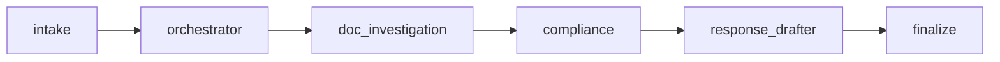
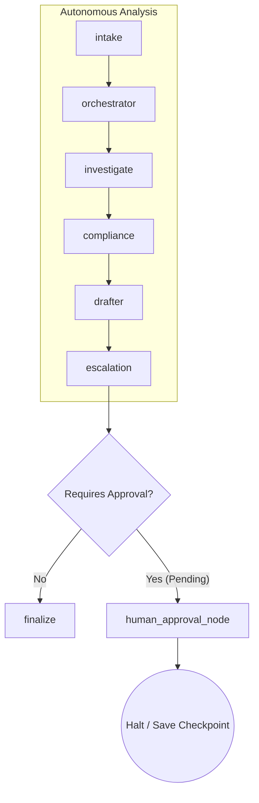
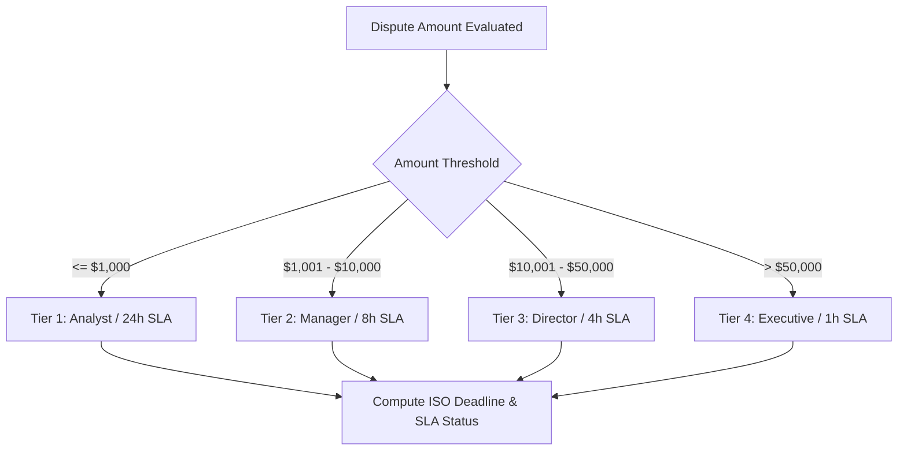
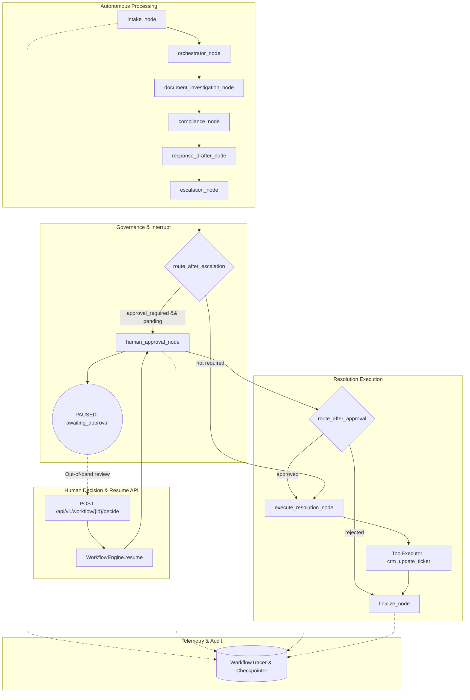

# Phase 11 — Project System Design Evolution

## Overview & Architectural Goals

Phase 11 introduces **Human-in-the-Loop (HITL) runtime orchestration, dynamic tiered escalation routing, deterministic SLA tracking, and authorized resolution execution**.

Prior to Phase 11, Phase 10 established the foundation of a compiled LangGraph state graph with checkpointers and tracing, but executions proceeded strictly non-interactively from document intake to final response drafting. Phase 11 bridges the gap between autonomous AI synthesis and enterprise risk governance by providing resilient pause/resume barriers and transactional tool resolution.

---

## Evolution Stages: Simple to Advanced

### Stage 1: Initial Linear Execution (Phase 10 Baseline)

In the Phase 10 baseline, the graph traversed straight from `intake` through `compliance` to `response_drafter` and `finalize`. If a compliance violation occurred, the process merely set status flags but did not pause for human intervention.

---

### Stage 2: Introducing the Human Approval Interrupt Gate (P11-1)

To protect corporate capital and adhere to compliance boundaries, we introduce `human_approval_node` and conditional routing after `escalation_node`. When `approval_required == True`, the node halts execution and freezes the state in the `WorkflowCheckpointer`.

---

### Stage 3: Tiered Escalation Routing & Dynamic SLA Calculation (P11-3)

High-value transactions cannot simply sit in a single generic queue. We integrated `EscalationRouter` to inspect dollar exposure and assign corporate hierarchy tiers and SLA deadlines:

---

### Stage 4: Advanced End-to-End Runtime with Authorized Tool Execution (P11-2, P11-4, P11-5)

The complete Phase 11 architecture links external management APIs, persistent checkpoint restoration, and shared tool execution paths for automated resolution.

---

## Key Design Decisions & Trade-Offs

1. **State Immobility via Checkpoints vs. Active Long-Polling:**
   - *Decision:* Halt the graph completely and store state in SQLite/memory rather than keeping worker threads sleeping or waiting.
   - *Rationale:* Web servers and worker processes scale horizontally without holding persistent thread locks or socket connections open during multi-hour or multi-day human reviews.
2. **Idempotent Node Re-Entry:**
   - *Decision:* `escalation_node` checks `approval_status`: if already `"approved"` or `"rejected"`, it does not overwrite the status back to `"pending"`.
   - *Rationale:* Ensures that resuming a workflow from the beginning or from intermediate checkpoints does not wipe out human-provided decisions.
3. **Unified Tool Execution Path (`execute_resolution_node`):**
   - *Decision:* Reuse Phase 6 `ToolExecutor` (`crm_update_ticket`, `db_read_records`) for workflow resolutions.
   - *Rationale:* Guarantees role-based access control (RBAC), tool argument validation, and audit logging remain identical across conversational agents and workflow engines.
